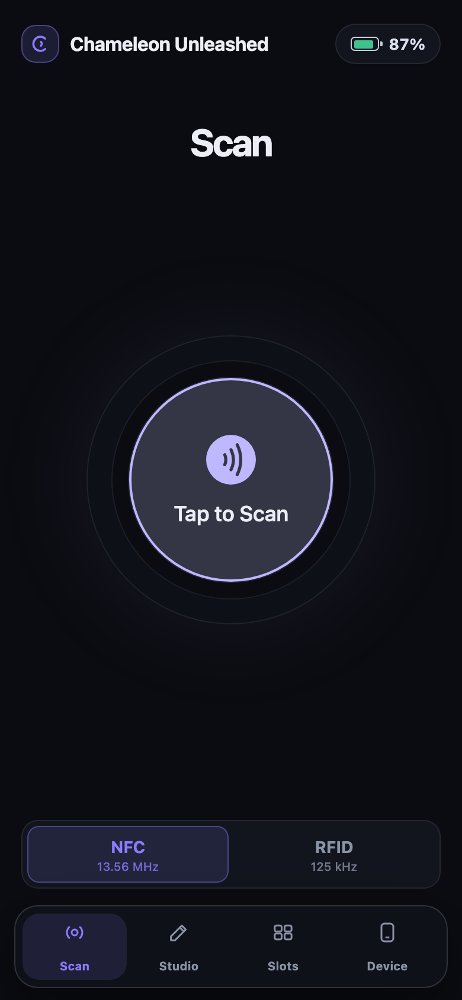
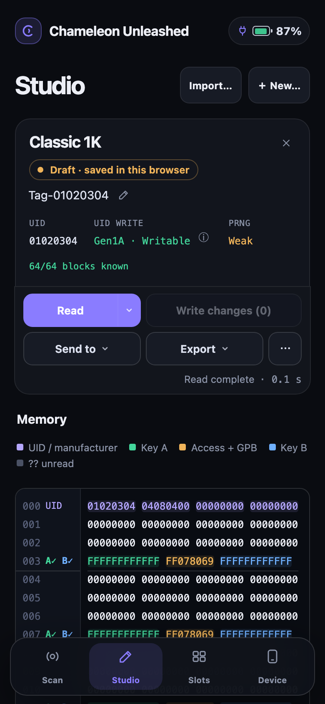
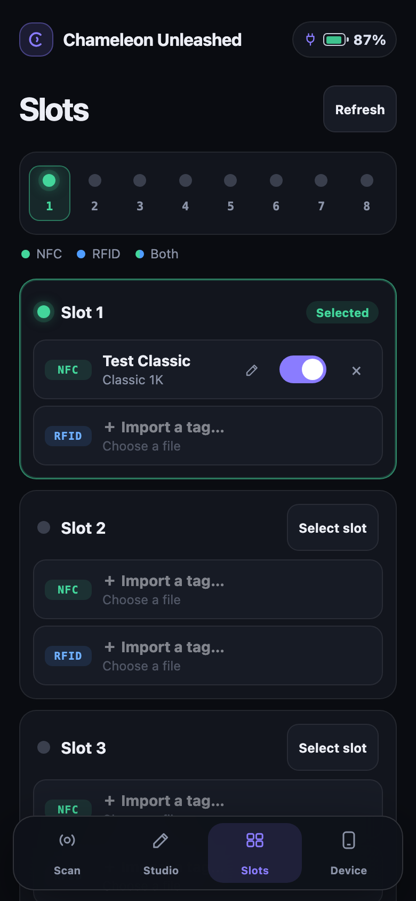

<h1 align="center">Chameleon Unleashed</h1>

<p align="center">
  <strong>Experimental firmware.</strong>
</p>

<p align="center">
  
</p>

An opinionated Chameleon Ultra fork with faster MIFARE Classic recovery and
emulation, a web interface over USB or Bluetooth, and experimental NFC-B/NFC-V support.

None of this would exist without [ChameleonUltra](https://github.com/RfidResearchGroup/ChameleonUltra)
and the people who built its firmware, hardware, tools and research. They deserve
the credit for the foundation this fork stands on.

[Features](#whats-different) · [Screenshots](#see-it-in-action) ·
[Performance](docs/performance.md) · [Before you flash](#before-you-flash) ·
[Install](#quick-installation) · [Documentation](docs/README.md) · [Changelog](CHANGELOG.md)

## What's different?

- **Much faster RF wake-up.** From around **1.8 seconds with animations** to
  roughly **16 ms for Classic** and **23 ms for SLIX-L** in development benchmarks.
- **Faster MIFARE Classic emulation.** Optimized frame delay times (FDT), close
  to those of real tags.
  [See timing measurements →](docs/performance.md#mifare-classic-emulation-timing)
- **Faster MIFARE Classic AutoPwn.** Optimized key recovery and card reading
  through the CLI and web interface.
- **A web interface over USB or Bluetooth.** Scan cards, inspect captures and
  manage emulation slots from a browser, including on compatible smartphones.
  Save resources for offline use.
- **Browser updates and USB web recovery.** Install a release or local firmware ZIP;
  recover over USB if the application will not start.
- **A native Rust CLI.** An interactive console for reading cards, managing slots
  and updating firmware over USB.
- **Experimental NFC-B and NFC-V reading and emulation.** Support for selected
  tags, including ST25TB and SLIX/SLIX-L. Results may vary across tags, readers
  and hardware.
- **ST25TB tearoff.** Built-in tearoff tooling for experimenting with ST25TB counters.
- **Real-time NFC-A and NFC-V sniffing.** Stream traffic over USB to the Rust CLI,
  with protocol annotations and capture export. Frames may be missed or truncated.

## See it in action

| Scan | Studio | Slots |
| :---: | :---: | :---: |
| <a href="docs/images/readme/web-scan.png"></a> | <a href="docs/images/readme/web-studio.png"></a> | <a href="docs/images/readme/web-slots.png"></a> |

## Web interface

Connect an Ultra running matching firmware over USB and open
[192.168.16.1](http://192.168.16.1) in your browser. Use Scan to read a tag, Studio
to inspect it, and Slots to save it for emulation.

For Bluetooth, open the [web app](https://seclabz.github.io/ChameleonUnleashed/app/),
wake the Ultra and choose **Connect Bluetooth** in Chrome or another browser with
Web Bluetooth support. Safari and Firefox do not provide native Web Bluetooth.

The first use needs Internet access to download matching CDN resources, which
are saved in your browser. Before going offline, check
**Device → Offline use → Ready offline**. [Web guide →](software/web/README.md)

To update over USB or Bluetooth, choose **Device → Firmware update**, or use the CLI
with a release archive. USB web recovery remains accessible with **A + USB** if the
application will not start, after the first installation below.
[Updates and recovery →](docs/web-updates.md)

## Native CLI

Connect one device and run:

```sh
chameleon info
chameleon hf search
```

Run `chameleon` for the interactive console, or add `--port DEVICE_PORT`
to select a device. [Hands-on CLI guide →](software/rust/README.md)

## Before you flash

This fork is where I experiment with what I want my Chameleon Ultra to do.
The priorities are my own. Expect rough edges and things that change.

I use AI heavily to develop this firmware. I try to keep control of what goes
in, but some AI slop will probably slip through. Development moves fast, and not
everything gets tested as thoroughly as it should. That tradeoff also lets me
explore ideas and ship features I find cool. This is an RFID playground, not
nuclear power plant software—but bugs are still bugs, and I'd rather be upfront
about them.

I test on a clone. Features like the very experimental NFC-B and NFC-V support
may behave differently or fail entirely on other hardware. Treat them as
experiments, not promises.

If you want a polished, stable experience, go with the
[original ChameleonUltra project](https://github.com/RfidResearchGroup/ChameleonUltra).

## Quick installation

Flash a prebuilt firmware package over USB using the native CLI. This needs
no Rust, Python or `nrfutil`.

Use the same procedure for installation, reinstallation and future updates.
It also enables browser updates on older devices.
**Export your saved tags before the first installation:** migration may overwrite them.

1. From [GitHub Releases](https://github.com/SecLabz/ChameleonUnleashed/releases),
   download the **archive matching your OS and architecture**, for example
   `ChameleonUnleashed-v<version>-macos-arm64.zip` for an Apple Silicon Mac.
   See [archive names](docs/releases.md) for other platforms.
2. Extract that outer archive. Inside are `chameleon` (`chameleon.exe` on Windows),
   `firmware.zip` and `INSTALL.txt`. **Keep `firmware.zip` intact, next to the CLI:**
   it is the firmware package passed to the commands below.
3. Connect one Chameleon Ultra with a USB data cable. Close any other client
   using the device.
4. Open a terminal in that folder, run the command for your OS below, and
   confirm the update when prompted.

**macOS / Linux**

```sh
chmod +x chameleon
./chameleon flash firmware.zip
```

**Windows (PowerShell)**

```powershell
.\chameleon.exe flash firmware.zip
```

The CLI switches the Ultra into USB DFU mode automatically. Keep it connected
until the update succeeds and the application restarts. Then open
[http://192.168.16.1](http://192.168.16.1) in your browser.

**If automatic DFU entry fails:** power the Ultra off, hold **B**, plug in USB,
then release **B**. LEDs **4 and 5** should blink. Run the same flash command again.

## Local development

From the repository root:

```sh
./dev build cli  # Build the native Rust CLI
./dev flash      # Build and flash the application over USB
./dev serve      # Run the local web interface connected to the Ultra
```

See the [development guide](docs/README.md#local-development) for prerequisites
and build options, including shared libraries and GitHub Pages.

## Attribution and license

Chameleon Unleashed builds on [ChameleonUltra](https://github.com/RfidResearchGroup/ChameleonUltra)
and retains its hardware, firmware, Python client and third-party notices.
See [AUTHORS.md](AUTHORS.md), [LICENSE](LICENSE),
[web dependency notices](software/web/THIRD_PARTY.txt), notices in source files
and the [upstream wiki](https://github.com/RfidResearchGroup/ChameleonUltra/wiki).
