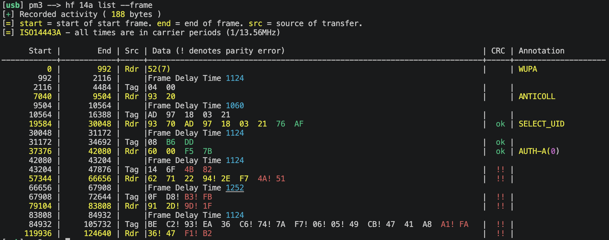

# Performance & measurements

[← Back to the project](../README.md#whats-different)

## MIFARE Classic emulation timing

Proxmark3 reading an emulated MIFARE Classic tag, with frame delay times shown
in the `hf 14a list --frame` trace.

For comparison, see the [MIFARE Classic response timing in the original ChameleonUltra technical whitepaper](https://github.com/RfidResearchGroup/ChameleonUltra/wiki/technical_whitepaper#ultra-fast-response-speed-and-low-interaction-delaymifare-classic).
