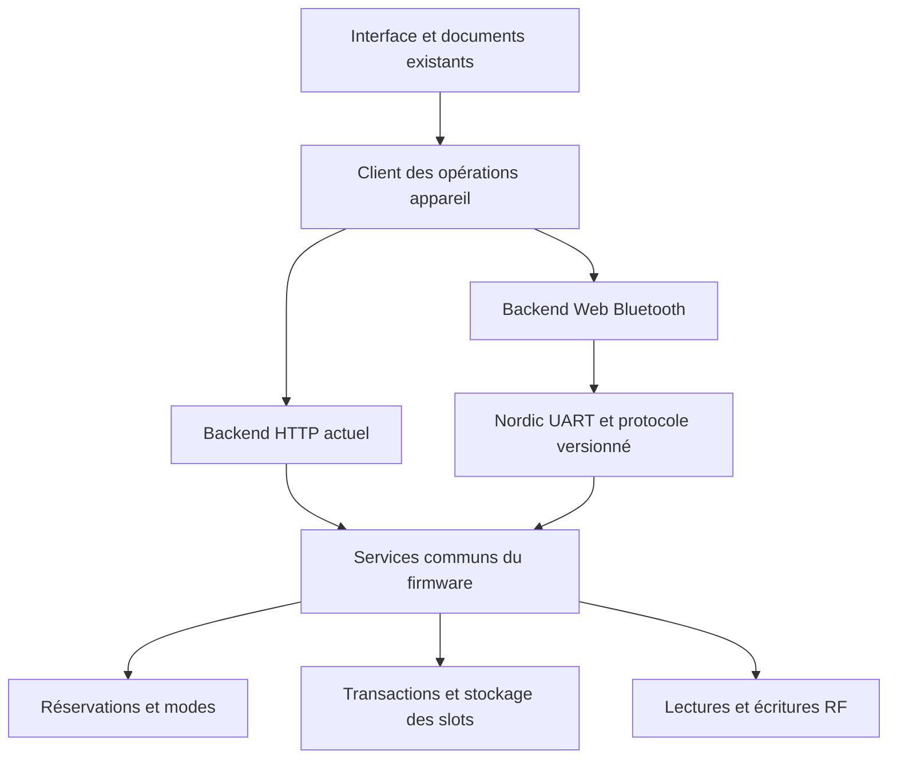

# Faisabilité Web Bluetooth et développement autonome

Étude du 6 novembre 2026, sur le code du commit `8176b34`.
Périmètre : reproduire les fonctions de **l’interface web actuelle** sur un
Chameleon Ultra, avec une liaison BLE directe depuis le navigateur.

## Avancement après réalisation sur `codex/web-bluetooth`

**Décision de périmètre : l’émulation NFC-V et NFC-B n’est pas prise en charge
pendant une connexion BLE.** Les images SLIX, SLIX-L et ST25TB peuvent toujours
être lues, éditées et transférées dans les slots par BLE. Déconnecter ensuite
le Bluetooth pour utiliser leur émulation autonome. Cette exclusion ne concerne
pas les fonctions **lecteur** NFC-V/NFC-B : scan, lecture, écriture et tear-off
restent dans le périmètre de validation. Les autres émulations restent à qualifier.

La suite de cette étude conserve le diagnostic de référence. Les points suivants
ont depuis été implémentés et testés ; ils remplacent les constats de blocage
initiaux sans constituer une qualification complète de la radio :

- La lecture d’un vrai SLIX a révélé un défaut de coexistence : inventaire,
  informations système et mémoire réussissaient sans BLE, échouaient en BLE et
  même en USB dès qu’une connexion BLE était active, puis réussissaient après
  déconnexion. Le correctif `4c011bf`, installé sur l’Ultra, réserve la radio
  seulement pendant l’émission et termine ensuite la capture DMA complète de
  11 264 échantillons, avec une demande d’horloge indépendante de l’émulation.
  Les 16 commandes de comparaison USB/BLE réussissent, puis la vraie interface
  Web Bluetooth lit et exporte les 28 blocs du SLIX, identiques à l’USB, sans
  repli HTTP ni écriture RF. Les huit slots, leurs données et les réglages sont
  préservés. Les 211 tests hôtes passent. Cette preuve concerne un SLIX non
  protégé alimenté en USB ; Bluefy réel, batterie, écritures et autres modèles
  restent à qualifier. L’exclusion de l’émulation NFC-V/NFC-B ne change pas.
  Après les campagnes Classic et les déplacements signalés, le SLIX n’est
  plus détecté : un inventaire USB final sur `ac7e5ed`, puis trois avant et
  trois après redémarrage de l’application, répondent `0001` sans BLE connecté.
  La position actuelle du tag reste à confirmer ; la cause n’est pas établie.
  Cela ne qualifie pas un passage positif NFC-V vers NFC-A et ne remplace pas
  la preuve précédente sur `4c011bf`. Aucune écriture du SLIX n’a été effectuée.
- La relecture d’un document Classic 2K existant pouvait remplacer ses 128 blocs
  par 64, car le moteur utilisait uniquement le SAK observé `08`. Le modèle connu
  détermine maintenant la géométrie après vérification de l’UID, du SAK et de
  l’ATQA, tout en conservant l’identité RF réelle. Les régressions avec le WASM
  de production et les parcours Chromium/WebKit vérifient les secteurs 0–31,
  les blocs supérieurs, les lectures partielles et la conservation du document
  si l’identité diffère. Le nouveau scan peut maintenant reconnaître les ATS
  connus des Plus S/X SL1, validés avec TL/CRC et une identité cohérente, sans
  transformer le SAK réel `08`. L’inspection expose cette preuve optionnelle
  sans nouvel échange RF ; les anciens firmwares négocient le contrat de
  lecture précédent après un refus explicite du format. Les 292 tests JS et
  211 tests hôtes passent ; les 320 parcours Chromium/WebKit passent avant le
  complément de conservation ATS, puis ses quatre parcours ciblés passent.
  Le firmware `71549de` est installé, avec sauvegarde et comparaison de tous
  les slots et réglages. Après les quatre pannes d’arrêt qualifiées, la vraie
  interface BLE reconnaît le nouveau scan 2K puis lit et exporte ses 128 blocs
  et 32 paires de clés identiques à l’USB, en conservant SAK `08` et ATS.
  La clôture de trace du premier essai coupait un rafraîchissement des slots
  en cours ; après correction du banc, le nouvel essai passe avec 220 opérations
  GATT sans erreur ni réponse en attente. Les deux essais arrêtent le PM3 et
  restaurent toute sa RAM. Cette preuve concerne une simulation Plus X SL1 avec
  clés du dictionnaire, sous alimentation USB ; elle ne qualifie pas les écritures.
  La version finale `ac7e5ed`, installée ensuite pour intégrer aussi la
  conservation ATS dans l’interface USB, repasse le même parcours 2K :
  128 blocs, 32 paires de clés et identité identiques à l’USB ; 217 opérations
  GATT sans erreur ni réponse en attente. Sauvegarde fraîche, comparaison des
  huit slots/réglages et restauration PM3 confirment leur conservation.
  Le refus d’écriture du bloc 126 en USB sur `ac7e5ed` est reproduit avec une
  simulation PM3 2K, malgré une lecture complète réussie. Le correctif suivant
  exige un ATS Plus S/X SL1 valide et deux sélections identiques avant les
  mutations du modèle 6 ; timeout/configuration sont restaurés et les autres
  tailles conservent leur séquence RF. Le formatage prépare désormais 128 blocs
  et 32 secteurs ; la réparation conserve le SAK observé `08` ou `10`.
  Le WASM réel fournit un SAK canonique `08`, que l’ancienne validation C
  refusait en exigeant `10`. Les 212 tests hôtes, 294 tests JS et 48 parcours
  navigateur ciblés passent. La nouvelle maintenance normale 2K ajoute un
  octet de garde ATS : 20 octets en lecture, 52 en précontrôle/écriture, sans
  repli vers une requête non protégée si le firmware refuse. Le contrat manuel
  de 19/51 octets reste disponible pour réparer une identité abîmée avec un
  modèle connu explicitement fourni. Les tests vérifient ce chemin avec le
  vrai SAK canonique `08` et le maintien des anciennes requêtes `10`. Le firmware
  compile. Installé sous `bdc0067` après sauvegarde, il réussit les écritures
  BLE des blocs 1 et 126, leur contrôle USB complet et leur restauration, ainsi
  que l’annulation et le refus d’une capture périmée : 231 opérations GATT sans
  erreur de trame ni réponse en attente. Cela concerne la RAM PM3 synthétique.
  Les deux essais des clés/droits du secteur 31 s’arrêtent avant mutation sur
  des lectures USB partielles des secteurs 16 puis 26. Les quatre refus modèle 6
  sur une simulation 1K sont observés, mais le contrôle mémoire suivant est
  également partiel. Ces premiers essais ne qualifiaient pas ces parcours.
  Une mesure sans écriture observe 64 lectures complètes avant redémarrage,
  une lecture partielle parmi 64 après, puis dix précontrôles ATS réussis suivis
  de 64 lectures complètes. La cause RF n’est pas établie ; le redémarrage ne
  la résout pas. PM3, slots, données et réglages sont restaurés/préservés.
  Un diagnostic optionnel de `2027` conserve maintenant l’erreur brute du
  premier bloc en échec, avec son indice, après le masque et les données
  historiques. Les appels existants et leur séquence RF restent inchangés.
  Les tests C couvrent les deux géométries et les positions d’échec, et les
  314 tests JS passent. Le banc 2K sous `265ddf2` termine ses six phases
  USB/BLE : 408 commandes RF et 384 lectures de secteurs complètes, sans
  retenter les blocs manquants. Les 166 opérations GATT sont sans erreur,
  réponse en attente ou repli HTTP. Arrêt, ping, restauration des 4096 octets
  PM3 et préservation de toutes les images/réglages de l’Ultra passent. Cette
  mesure valide le diagnostic, sans reproduire ni corriger les anciennes
  lectures partielles. Le parcours clés 2K du banc `42300a8` passe ensuite
  avec cette application et l’interface publiée `d5a58d3`, en trois simulations
  bornées : annulation intacte, nouvelles clés A/B et droits du secteur 31,
  refus des anciennes clés, relecture BLE, écriture/restauration du bloc 124
  avec B, puis retour des clés/droits d’origine et nouvelle lecture complète.
  Les 661 opérations GATT et 193 contrôles USB de secteurs passent sans repli
  HTTP ni erreur de trame. Les trois arrêts/pings, restaurations et relectures
  des 4096 octets PM3 passent ; tous les slots/images/réglages de l’Ultra sont
  préservés. Cela qualifie la RAM PM3 synthétique, sans étendre cette preuve à
  l’EEPROM, au refus réel d’écriture avec A ou au formatage complet. Les anciens
  échecs et leur cause RF non résolue restent documentés.
  La version compatible `633159a` est ensuite installée sans changement des
  huit slots, images, réglages ou slot actif. Sur le vrai lien BLE natif,
  lecture, précontrôle, écriture et restauration protégés du bloc 126 passent
  en 2K. Une simulation 1K refuse la requête protégée modèle 6, tout en
  acceptant ses lectures modèle 1 avant/après. Les deux arrêts autonomes,
  pings directs et restaurations des 4096 octets PM3 passent. Cette preuve
  porte sur les commandes unitaires en RAM simulée ; elle ne qualifie pas un
  formatage complet depuis l’interface Web Bluetooth ni l’EEPROM.
  Les 12 tests hébergés et 12 tests WebKit mobile passent aussi. Un nouvel
  inventaire SLIX USB sans BLE répond encore `0001` ; un inventaire PM3
  indépendant ne rapporte pas non plus d’UID à la position actuelle. La cause
  reste inconnue et aucune écriture du SLIX n’a été effectuée.
  La suite navigateur complète passe 322 cas sur 324 ; les deux nouveaux cas
  négatifs visaient le mauvais panneau. Après correction du sélecteur, les
  quatre cas ciblés positifs/négatifs passent sans changement de production.
  Le parcours distinct de copie vers un tag vérifie maintenant un ATS frais
  avant lecture de la cible puis après confirmation. Il distingue les Plus
  S/X SL1 2K et refuse les deux sens de mauvaise capacité, une inspection
  ancienne/indisponible ou un ATS non reconnu. Le contrôle final du clonage
  récupère aussi l’ATS omis par le scan Classic. Les 311 tests JS passent,
  avec géométrie et planification WASM de production ; les 54 parcours ciblés
  Chromium/WebKit passent aussi. La vraie interface Web Bluetooth réussit
  ensuite l’annulation sans changement, la copie des blocs 1/126, leurs
  contrôles USB complets sur 128 blocs et leur restauration. La campagne est
  divisée en deux simulations bornées à 180 secondes, arrêtées avec ping et
  restauration des 4096 octets entre les phases et à la fin : 1 131 échanges
  GATT, sans erreur de trame ni réponse en attente. Le premier essai trop long
  avait atteint la butée, qui avait aussi arrêté/restauré le PM3 ; il reste
  archivé. Les slots/images/réglages Ultra sont préservés. Cette preuve porte
  sur la copie de données en RAM PM3 synthétique, pas l’UID, les clés ou l’EEPROM.
  Le frontend hébergé `d5a58d3` est publié dans le dépôt temporaire, avec neuf
  empreintes publiques et le parcours hors ligne contrôlés. Le firmware
  applicatif `460ca13` synchronise ensuite le frontend servi par USB : fichiers
  réellement servis identiques au build, module applicatif identique à celui
  de la préversion, huit slots/images/réglages préservés. Une connexion BLE
  réelle, l’ouverture d’un slot, la déconnexion et le retour explicite au
  backend USB passent sur ce firmware. Les 12 tests hébergés et 12 tests
  WebKit mobile passent ; cela ne qualifie pas encore Bluefy sur l’iPhone réel.
  GetVersion et les variantes de clones 2K restent aussi
  à qualifier, sans ajouter d’exclusion.
  La distinction SL1/SL2 et les pistes RATS/GetVersion figurent
  dans [NXP AN10833, figure 1](https://www.nxp.com/docs/en/application-note/AN10833.pdf).
- Le firmware expose les mêmes services web via la commande BLE **1090**,
  contrat **1** : sessions, commandes RF autorisées, réglages, transactions de
  slots et contrôle du job tear-off. Les réservations appartiennent à leur
  transport ; une déconnexion HTTP ne ferme plus une réservation BLE.
- Le frontend possède une file BLE, un parseur de trames, une corrélation des
  réponses, un contrôle de compatibilité et une connexion explicite. Aucun
  rejeu automatique de mutation ni repli HTTP après coupure.
- Le contrôle final des sauvegardes a révélé puis fait corriger un faux
  changement de révision : une petite image conservait les octets inutilisés
  d’une grande image dans le tampon HF/LF partagé. Ces octets sont maintenant
  remis à zéro au chargement. Le test hôte reproduit l’échec avant correction
  et valide les allers-retours entre tailles HF et LF ; les images utiles,
  noms et réglages ne sont pas modifiés. Le firmware corrigé
  `v1.0.0-28-g76f8159` a ensuite passé la campagne matérielle : retour au slot
  SLIX avec révision initiale identique, réglages persistants après deux resets,
  96 lectures RF Classic et transactions dans le slot 8, ensuite vidé.
- Deux onglets Chromium réels ont vérifié l’exclusion du second propriétaire,
  sans interrompre le premier, puis la reprise après déconnexion et fermeture
  d’onglet. L’identité du verrou et les identifiants clients sont enregistrés,
  sans repli HTTP. Ce verrou est limité à la même origine et partition du
  navigateur ; conserver un seul client BLE actif entre applications ou profils.
- Un banc de performances en lecture seule compare maintenant USB et BLE dans
  le même Chromium, avec les vrais modules de transport et snapshots USB
  indépendants. Douze lectures appareil, 24 lectures de métadonnées, 24 requêtes
  lancées par groupes de huit et six transferts de chaque image ont tous
  conservé les données. Sur ce banc alimenté en USB, les médianes sont de
  120 ms pour les informations appareil en BLE (182 ms en USB), 152 ms pour
  une réponse de 512 octets (180 ms en USB) et 555 ms pour l’image Classic de
  1047 octets (680 ms en USB). Les images SLIX-L et ST25TB passent aussi ;
  l’état, les huit métadonnées et toutes les images HF/LF sont préservés.
  Ces mesures ne qualifient pas les performances RF, les écritures, la batterie,
  les images plus grandes ou les autres plateformes. Le PM3 n’est pas utilisé.
- Les sept réglages hors appairage ont été changés puis restaurés depuis
  l’interface en BLE réel : animation, quatre actions des boutons, sommeil et
  seuil d’appui long. Chaque valeur a été relue indépendamment en USB, avec
  comparaison des autres réglages. Une réservation lecteur USB fait refuser
  la sauvegarde BLE ; les huit métadonnées de slots et le mode sont préservés.
  Un scénario distinct a ensuite vérifié leur persistance après redémarrage
  réel : modification des sept valeurs en BLE, passage par la récupération
  USB sans mise à jour, retour à l’application et reconnexion BLE. Les valeurs
  initiales ont été restaurées en BLE puis confirmées après un second
  redémarrage. Les huit métadonnées et les empreintes des images HF/LF sont
  préservées. Cela qualifie le reset logiciel alimenté en USB, pas une coupure
  de batterie ; l’appairage et le PIN restent inchangés.
- Les cas matériels « aucun tag » ont été comparés en USB et BLE pour NFC-A,
  NFC-B, NFC-V, EM410x, Viking, HID Prox, ioProx, PAC et Jablotron. Les statuts
  et données d’erreur correspondent. Un client USB ne peut ni fermer ni
  renouveler la réservation lecteur BLE ; fermer l’onglet sans END libère
  cette réservation et restaure le mode, les réglages et les métadonnées.
  Ce contrôle ne constitue pas une lecture RF positive.
- Un contrôle lecteur NFC-A **positif** a ensuite réussi avec la simulation du
  Proxmark3 : trois scans USB de l’UID `11223344`, puis capture depuis la vraie
  interface BLE et export JSON avec les mêmes UID, ATQA, SAK et ATS. Aucun
  repli HTTP ; après arrêt de la simulation, un nouveau scan USB confirme
  l’absence du tag. Le mode, les réglages et les huit métadonnées sont préservés.
  Cela ne qualifie pas la récupération de mémoire Classic ni les écritures RF.
- Une lecture mémoire NTAG213 positive a ensuite comparé USB et vraie interface
  BLE : détection automatique, UID, version, 43 pages publiques, compteur et
  signature synthétique identiques dans l’export JSON. Les pages mot de passe
  et PACK restent inconnues. La simulation utilise uniquement la RAM volatile
  du PM3, sauvegardée puis restaurée et relue intégralement. Aucun repli HTTP,
  aucune écriture de tag ; cela ne qualifie ni les accès protégés ni les autres
  profils Type 2 ou l’authenticité d’une signature.
- Le parcours d’écriture NTAG213 a aussi été exercé vers la RAM du PM3 :
  contrôle USB avec relecture et refus d’une valeur périmée, annulation depuis
  l’interface BLE sans modification, écriture de deux pages puis restauration
  par cette même interface. Les 43 pages publiques sont comparées en USB après
  chaque étape. Une modification externe après capture fait refuser l’écriture
  BLE, sans changement supplémentaire et avec invalidation de la lecture
  précédente. Le banc et l’Ultra sont restaurés. Cela qualifie les échanges RF
  avec la RAM simulée, pas les protections ou la programmation EEPROM d’un tag.
- Le lecteur Classic 1K a maintenant passé deux parcours positifs. La référence
  USB authentifie les clés A et B distinctes sur les 16 secteurs et compare
  les 48 blocs de données et les droits d’accès. L’interface BLE réelle utilise
  son dictionnaire intégré et exporte les 64 blocs et les 32 clés identiques.
  Le second parcours annule sans modifier, écrit deux blocs de données, les
  vérifie indépendamment en USB et les restaure dans l’interface. Une modification
  externe fait refuser la capture périmée avec zéro bloc terminé et invalide
  le lien de lecture ; la mémoire complète est vérifiée à chaque étape.
  L’arrêt direct, la restauration des 4096 octets PM3 et toutes les images,
  métadonnées et configurations Ultra sont préservés. Ces essais qualifient
  les clés connues du dictionnaire et les écritures de données vers la RAM PM3,
  pas les clés inconnues, UID/bloc 0, autres tailles ou EEPROM. Le parcours
  séparé des trailers ci-dessous étend ensuite cette couverture.
- Le précontrôle de modification des clés a révélé un défaut de l’interface,
  reproduit sur l’Ultra : pour un trailer modifiable seulement avec B, le
  refus `0x75` avec A empêchait d’essayer B, pourtant acceptée en USB. Le
  contrôle sans écriture essaie désormais l’autre clé connue ; aucun envoi
  de mutation avant validation de tous les trailers et aucun rejeu d’écriture.
  Les deux régressions échouaient avant la correction et passent ensuite ;
  les 273 tests JS et dix parcours Classic Chromium/WebKit ciblés réussissent.
  Un autre essai s’est arrêté, avant écriture, sur une lecture USB partielle
  du secteur 6 (`0007`, trailer 27 manquant) après annulation dans l’interface
  et avec BLE connecté. Cet incident RF reste archivé et non résolu ; il ne
  permet pas à lui seul d’incriminer le transport BLE. L’arrêt et la restauration
  intégrale du PM3 ont réussi.
  Le parcours corrigé a ensuite réussi : annulation, nouvelles clés A/B et
  nouveaux octets d’accès du secteur 1, anciennes clés refusées en USB,
  relecture complète par l’interface, restauration des clés/droits initiaux,
  nouvelles clés refusées et dernière relecture complète. Chaque changement
  de sécurité invalide la lecture précédente. La RAM PM3 et toutes les données
  Ultra sont préservées ; l’incident de lecture partielle reste non résolu.
- Une extension du test a aussi rencontré un statut BCC `5` pendant le scan
  ou l’inspection BLE, après les contrôles USB réussis et avant écriture.
  Ce second incident RF reste non résolu. Le banc journalise désormais les
  vrais fragments GATT et les décode avec le parseur de production pour
  distinguer statut RF, commande et défaut de trame. Un premier journal contient
  241 opérations sans erreur de trame et confirme le contrôle A refusé,
  le contrôle B accepté puis l’écriture du trailer avec B.
  Le contrôle négatif d’écriture de données avec A n’est pas qualifiant sur
  cette simulation PM3 : son code acquitte aussi le cas interdit, et l’Ultra
  répond `0x75` plutôt qu’un refus NAK. La RAM a été restaurée et cet essai
  reste archivé ; il ne sert pas de preuve de protection d’un tag physique.
  Le parcours positif étendu a ensuite réussi en 94,9 s : écriture puis
  restauration d’un bloc avec B sous droits `100`, mémoire comparée en USB
  après chaque étape, puis clés/droits initiaux restaurés. Les 365 opérations
  GATT réelles sont décodées sans erreur de trame ; les deux écritures de
  données et deux écritures de trailer utilisent B, sans rejeu de mutation.
  Toutes les données Ultra et la RAM PM3 sont préservées.
- Une caractérisation séparée a ensuite achevé 48 cycles (144 commandes RF)
  sur six phases USB/BLE. Les quatre erreurs BCC proviennent toutes de
  l’inspection `2040` : deux en USB et deux en BLE, pendant les phases avec
  connexion BLE. Les deux phases sans connexion n’en ont pas observé. Les
  48 sélections NFC-A et 48 lectures du secteur 6 sont complètes ; les trames
  GATT sont valides et toutes les données du banc sont préservées. Cette
  campagne localise le défaut mais ne prouve ni sa cause ni la fiabilité RF.
  Son succès signifie que les mesures et le nettoyage ont abouti, pas que
  les quatre erreurs deviennent acceptables pour la qualification.
- Le sélecteur NFC-A commun contrôlait le BCC sans vérifier la longueur de
  la réponse anticollision. Il exige maintenant 40 bits UID+BCC, 24 bits SAK
  et trois cascades au maximum. Le test compilant le vrai sélecteur échouait
  avant correction et passe après, avec sanitizers ; huit tests de capture et
  quatre tests de détection/écriture protégée passent. Les UID de 4/7/10 octets
  et la réparation explicite d’un vrai BCC erroné restent valides. Cette
  correction évite les faux diagnostics BCC sur trame courte. L’application
  seule a été flashée sur l’Ultra (`v1.0.0-41-gdbd62e9`), avec sauvegardes et
  état initial identiques, sans modifier le PM3 ni augmenter la RAM statique.
  Les 210 tests hôtes passent. La même campagne de 48 cycles constate encore
  quatre échecs d’inspection : trois statuts `2` et un statut `1`, sans statut
  BCC `5` ; sélections et lectures de secteur sont complètes. Ce résultat
  ne démontre ni une amélioration du taux d’échec ni sa cause physique.
  Les traces PM3 montrent aussi des réponses UID annoncées valides sans SELECT
  suivant, mais ne sont pas une capture analogique indépendante. Le banc
  conserve maintenant cette trace radio en plus de GATT ; la fiabilité RF
  reste non qualifiée. La lecture complète Classic à clés connues a aussi
  réussi sur ce nouveau firmware, avec 64 blocs et clés identiques en USB/BLE,
  arrêt autonome et sauvegarde finale entièrement préservée.
- L’attente IRQ utilisait encore un compteur global avançant par pas de
  10 ms pour le délai de 5 ms de l’inspection. Un tick immédiatement après
  la remise à zéro pouvait provoquer une expiration prématurée ; une réponse
  déjà signalée pouvait aussi être rejetée après retard du processeur.
  Le test compilant le vrai pilote reproduit le défaut avant correction et
  passe après. Toutes les attentes utilisent maintenant les ticks RTC depuis
  leur propre départ, avec les budgets existants et traitement prioritaire
  d’une complétion déjà observée. Aucun rejeu RF ni ajout de RAM statique.
  Les 211 tests hôtes passent. L’application seule (642496 octets) a été flashée
  sur l’Ultra en `v1.0.0-43-g1662597`, avec toutes les données et l’état initial
  préservés. La même campagne de 48 cycles et 144 commandes RF ne rencontre
  alors aucune erreur ni secteur partiel dans ses six phases. Les 107 opérations
  GATT sont valides et 25 rafraîchissements BLE accompagnent la phase USB sous
  charge. L’arrêt direct du PM3, sa RAM restaurée et sa disparition RF sont
  confirmés. Ce premier échantillon propre soutient la correction des délais,
  sans qualifier la fiabilité générale ni résoudre l’échec distinct d’émulation
  Classic.
  Trois répétitions indépendantes du même diagnostic passent ensuite : au total,
  **192 cycles, 576 commandes RF, aucun échec ni secteur partiel**, 425 opérations
  GATT valides et 97 rafraîchissements BLE concurrents. Les quatre arrêts directs,
  restaurations RAM et préservations de toutes les données Ultra sont confirmés.
  Les traces PM3 conservées comptent 9440 trames et 1034 anticollisions, sans la
  séquence UID valide puis abandon avant SELECT observée auparavant. Elles restent
  limitées et ne constituent pas une mesure analogique indépendante. Le correctif
  lecteur est étayé sur ce banc ; les rapports d’échec antérieurs restent conservés,
  et cette preuve ne qualifie ni les EEPROM physiques ni les autres familles RF.
- Les trois parcours complets Classic passent aussi sur ce firmware : lecture
  des 64 blocs et 16 paires de clés, annulation/écriture/restauration de données
  et refus d’une capture périmée, changement puis restauration des clés et droits
  avec écritures via B. Leurs 609 opérations GATT réelles sont sans erreur de trame,
  avec contrôles USB et nettoyage autonome réussis. Le premier essai de lecture
  NTAG213 échoue cependant au scan USB initial, statut `1`, avant connexion BLE.
  L’écriture/restauration NTAG213 suivante et trois répétitions de la lecture
  réussissent avec les critères inchangés, sans délai ni rejeu ajouté. Le premier
  échec reste ouvert : le message du client PM3 ne garantit pas une disponibilité
  RF côté appareil, mais cette piste de démarrage n’est pas une cause établie.
  Le banc Type 2 conserve désormais chaque réponse USB et la trace radio PM3 après
  arrêt/restauration pour analyser une prochaine occurrence.
- Une clé A du secteur 1 de la simulation Classic 1K a ensuite été remplacée
  par `D7C2A9E46135`, absente des 2511 clés du moteur WASM de production. Le
  contrôle USB refuse l’ancienne clé et authentifie la nouvelle ; aucune clé
  personnalisée n’est fournie au navigateur. L’interface BLE la récupère par
  **Nested**, puis les 64 blocs et 16 paires de clés correspondent au banc.
  Quatre acquisitions RF donnent huit observations, avec authentification réelle
  de la clé retrouvée et 121 opérations GATT sans erreur de trame. Aucune commande
  de mutation RF n’est envoyée. L’essai réussit en 47,6 s, avec arrêt autonome,
  RAM restaurée, absence RF et données Ultra préservées. Ce cas qualifie une
  récupération à PRNG faible ; StaticNested, Hardnested, Darkside et les autres
  tailles Classic restent à vérifier physiquement.
- Le PM3 possède maintenant un arrêt autonome éprouvé : superviseur séparé
  armé avant la simulation, libération du port série, `hw break` et vérification
  du contenu de `hw ping`. Les tests réels couvrent la fin normale, SIGKILL du
  propriétaire et un délai forcé à cinq secondes, avec disparition RF vérifiée
  après chaque arrêt. Le délai maximal accepté est de 180 secondes ; aucune
  pression physique sur le bouton n’est nécessaire dans ces cas testés.
  Le lancement USB attend l’enregistrement du PID auprès du superviseur.
  Celui-ci conserve aussi une copie des 4096 octets initiaux de RAM : un
  quatrième test réel détruit le propriétaire après modification de cette RAM,
  puis exige sa restauration exacte et une relecture indépendante. Ce cas a
  réussi ; les nouvelles familles de simulation restent interdites tant que
  leur arrêt logiciel n’a pas été vérifié séparément.
- Le précontrôle du mode complet Classic `hf mf sim` a ensuite échoué à la
  réouverture USB après arrêt du client. Une première réinitialisation USB a
  permis une récupération, mais la répétition a perdu le port série malgré
  les commandes ciblées du hub ; l’Ultra détectait encore `11223344`. Le lancement
  sans le canal conservé ouvert reste refusé. Cet échec du banc ne retire pas le
  lecteur Classic du périmètre et ne prouvait pas, à lui seul, une lecture mémoire.
- Après reconnexion physique du PM3, la nouvelle commande de récupération a
  réussi : identité Ultra et sauvegarde épinglées, arrêt/ping PM3, contrôle des
  4096 octets de RAM, absence RF et préservation de l’Ultra. Une seconde
  exécution a restauré une RAM volontairement différente, avec sauvegarde
  préalable et relecture exacte. Ses neuf tests logiciels passent également.
  Le canal d’arrêt conservé ouvert dans le superviseur a ensuite passé les
  quatre pannes réelles de `hf 14a sim`, y compris SIGKILL et restauration de
  RAM. Le parseur accepte le code diagnostic `FF` d’un ping réussi ; le test
  construit sur la trame capturée échouait avant correction et passe après.
  BREAK et PING sont espacés de 50 ms pour éviter leur regroupement USB.
  Quatorze tests logiciels passent. Le mode exact Classic 1K interactif a
  ensuite passé ses quatre pannes réelles avec le canal conservé ouvert :
  arrêt normal, SIGKILL, délai forcé et RAM modifiée puis restaurée. Chaque
  cas exige le ping direct, un ping CLI indépendant, les 4096 octets initiaux
  et l’absence de tag en USB ; le nettoyage complet prend environ 15,2 s.
  Le premier essai avec cinq secondes pour le ping direct a utilisé le secours
  et reste non qualifiant ; quinze secondes permettent la confirmation directe.
  Ce mode exige maintenant deux options explicites et une sauvegarde RAM ;
  les autres tailles et options d’attaque restent refusées.
- Le pilotage du job tear-off a aussi été exercé sur le vrai Ultra en champ
  vide : recherche d’une cible synthétique, état RUNNING, refus d’une autre
  commande RF, annulation puis état final identique en USB et BLE. Zéro
  écriture et nettoyage radio sont vérifiés. L’annulation BLE a été observée
  en 240 ms sur cet essai, polling compris ; ni le timing RF ni l’annulation
  pendant une écriture réelle ne sont qualifiés par ce scénario.
  Un second job est interrompu par fermeture de l’onglet sans CANCEL ni END :
  une nouvelle réservation USB confirme ensuite l’état annulé, zéro écriture
  et le nettoyage radio, avec restauration du mode et des métadonnées.
- La coexistence annonce BLE/émulation NFC-V a été corrigée. L’Ultra réel est
  découvrable avec le slot SLIX-L actif, sans arrêt préalable de son émulation.
  Une connexion native a aussi réussi avec le slot ST25TB actif ; le slot
  initial a ensuite été restauré.
- **Chromium a réellement connecté l’Ultra** : identité identique à celle lue
  en USB, liste des huit slots, ouverture d’une image dans Studio avec les
  requêtes HTTP appareil bloquées pendant la lecture BLE. Le même scénario a
  ensuite réussi depuis le paquet autonome sous préfixe, dont la page ne
  possède aucun backend HTTP appareil.
- Un scénario réel a écrit puis relu des copies Classic 1K, SLIX-L et ST25TB
  dans le slot 8 vide réservé au test, ainsi qu’une image LF. Nom UTF-8,
  activation de fréquence, effacement, révision périmée, préservation de l’autre
  fréquence, refus d’un propriétaire USB concurrent et abandon d’upload après
  déconnexion ont été vérifiés. Le slot de test a été vidé et les métadonnées,
  réglages, mode et slot actif initiaux ont été comparés.
- Une campagne distincte a ensuite sauvegardé les **25 formats stockables**
  dans le slot 8 vide réservé : quatre Classic, neuf Type 2, SLIX/SLIX-L,
  ST25TB, DESFire et huit LF. Chaque sauvegarde BLE est relue indépendamment
  en USB ; octets, nom, activation et révision de l’autre fréquence sont
  préservés. Les cas comprennent une image Classic 4K de 4374 octets avec
  champ ATS synthétique de 255 octets et un enregistrement DESFire de
  4497 octets. Un upload abandonné après 2000 octets laisse les deux images
  persistées intactes ; la reconnexion refuse l’ancien bail avec 409. Les
  deux fréquences ont ensuite été effacées en BLE, sans nettoyage de secours,
  et toutes les données/configurations initiales sont identiques. Cela
  qualifie le stockage et le transfert, pas la radio de chacun des formats.
- La distribution autonome accepte un préfixe de dépôt et conserve aussi
  l’interface complète. La réouverture réellement hors ligne avec un document
  et un nouveau worker de calcul a réussi dans Chromium et WebKit. WebKit
  valide ici les documents et le cache, pas une liaison BLE.
- Une comparaison RF de l’émulation Classic 1K est maintenant automatisée avec
  le Proxmark3 HF aligné : identité, authentification clé A, 48 blocs de données
  et droits d’accès des 16 secteurs, avec puis sans connexion BLE. Le premier
  essai a perdu une réponse au bloc 17 sous BLE après une référence complète
  réussie. Une comparaison ultérieure de 96 lectures de secteurs a réussi,
  sans résoudre cet échec intermittent. Le banc distingue désormais BLE au
  repos et rafraîchissements continus pendant les lectures. Cette campagne
  renforcée a également réussi ses 96 lectures, avec 64 rafraîchissements BLE,
  aucun repli HTTP et préservation complète des images et de l’état initial.
  Le succès d’une exécution ne résout pas la perte précédente. Cette fiabilité
  reste à qualifier ; l’émulation Classic n’est pas ajoutée aux exclusions.
- Le travail de récupération/mise à jour web d’une autre branche terminée a
  été intégré pour conserver le layout 2 déjà présent sur l’Ultra. La mise à
  jour web existe maintenant mais reste **USB uniquement**, avec indication
  explicite dans le parcours Bluetooth.

La vérification du périmètre retenu compte **292 tests JS**, **211 tests
hôtes firmware/packaging** (dont les **15 contrats web**) et **320 tests navigateur
Chromium/WebKit** réussis. Après le complément de conservation ATS, les quatre
parcours navigateur ciblés passent également. Les **12 tests du paquet hébergé**
et **12 tests WebKit mobile** réussissent aussi sur `ac7e5ed`.
Les tests
navigateur incluent les **20 cas hors ligne USB**. La campagne physique courante
compte **17 scénarios dont la dernière exécution a réussi** : informations et
slots, concurrence entre onglets et reconnexion, réglages restaurés,
persistance après redémarrage, lecteur sans tag, comparaison RF Classic,
transactions du slot 8, capture NFC-A positive, lecture et écriture NTAG213
depuis la simulation PM3, lecture et écriture de données Classic 1K à clés
connues, récupération Nested d’une clé Classic absente du dictionnaire,
changement/restauration des clés et droits Classic via B, performances
des lectures USB/BLE, matrice des
25 formats de slots avec abandon d’un gros upload et lecture complète du SLIX
physique avec le correctif `4c011bf`.
La comparaison RF Classic conserve
l’échec intermittent antérieur comme point non résolu. Le scénario sans tag
couvre aussi le contrôle du job tear-off, son annulation et la fermeture
d’onglet pendant son exécution. Le diagnostic de l’émulation exclue n’est pas
activé dans les campagnes normales.
Les preuves matérielles antérieures restent liées à leur version de firmware ;
les campagnes relancées après le correctif RTC sont détaillées ci-dessus.
Un défaut logiciel de transport a ensuite été reproduit : recevoir la réponse
avant la fin du dernier callback d’écriture désarmait le délai et pouvait figer
la file si ce callback restait bloqué. Le délai et la déconnexion couvrent
maintenant l’échange complet. Les deux régressions échouaient avant correction
et passent après, sans émission ni rejeu de la mutation en attente. Les 275 tests
JS, contrôles de code et six tests du paquet reconstruit passent ; cette modification
a depuis été exercée en lecture SLIX physique, en fonctionnement normal ; le
blocage artificiel d’un callback reste une preuve logicielle. L’essai manuel
iPhone/Bluefy reste distinct des preuves
Chromium et WebKit logicielles. Le matériel, réservé pendant cet essai, a été
rendu au banc autonome par l’utilisateur après le debug du SLIX.
La préparation Mini/4K ajoute des fixtures comparées à la géométrie du WASM réel,
des tests du secteur final de 16 blocs avec masques complets/partiels, et les
contrôles d’arrêt préalables. Le parcours 1K conserve le même SHA-256 de fixture.
Les 41 tests logiciels PM3 passent. Un nouveau format ne peut être lancé en
campagne normale sans son rapport complet des quatre pannes, lié à la commande,
au binaire client, au port série et à l’identité de firmware annoncée par le PM3.
Cette identité est comparée en lecture seule avant tout chargement de RAM.
Le test qui exige le refus d’un rapport périmé échoue avec l’ancien lanceur et
réussit avec le nouveau.
Le précontrôle expérimental reste limité à
30 secondes, avec canal d’arrêt conservé et sauvegarde des 4096 octets. Les tests
UI Mini/4K comparent la totalité des blocs et clés à l’USB. Le premier
précontrôle Mini sur le firmware Ultra
`4c011bf` n’a pas détecté la simulation (`0001`) ; le canal d’arrêt direct et la
restauration exacte de toute la RAM ont réussi. Un contrôle 1K déjà qualifié
auparavant ne détecte pas non plus sa simulation sur trois scans, alors que le
SLIX physique est encore lisible. L’alignement HF et la présence du SLIX dans le
montage empêchent donc de conclure à un défaut propre au Mini. Un contrôle
inverse lit l’émulation NFC-A de l’Ultra depuis le PM3 ; après redémarrage de
l’application, six contrôles 1K réussissent, mais le SLIX n’est plus détecté.
L’utilisateur signale aussi un déplacement du matériel : la cause de la reprise
RF n’est pas établie, ni le passage positif SLIX vers NFC-A.
Les précontrôles Mini et 4K réussissent ensuite chacun les quatre pannes avec
arrêt direct, identité PM3 inchangée et restauration des 4096 octets. La vraie
interface BLE lit les 20 blocs et cinq paires de clés Mini à l’identique de
l’USB. Le premier essai 4K perd la carte à l’authentification du secteur 5 ;
cet échec et sa restauration sont conservés. Après remise en place signalée
par l’utilisateur, le nouvel essai 4K lit et exporte les 256 blocs et 40 paires
de clés, identiques à l’USB : 268 opérations GATT sans erreur de trame ni
réponse en attente. Les slots, réglages et slot actif sont préservés, la simu
est arrêtée et toute la RAM PM3 restaurée. Cela ne prouve pas la fiabilité
générale RF ni des écritures EEPROM.
Le PM3 `--2k` annonce un SAK `08` avec RATS. Sur `71549de`, le nouveau scan
reconnaît son ATS Plus X SL1 et la campagne RF compare les 128 blocs et 32 paires
de clés en USB puis dans l’interface BLE. L’export conserve le SAK et l’ATS.
Le premier essai échoue seulement sur une clôture de trace trop précoce après
réussite de ces comparaisons ; le nouvel essai attend les réponses en cours
et passe sans requête pendante. Les échecs restent archivés. Les trois nouvelles
campagnes de tailles Mini/2K/4K restent des lectures de RAM PM3, sans preuve
d’écriture sur une carte physique.
Le contrôle du paquet en WebKit tactile à 320 px a révélé un bouton **Device**
masqué par la barre d’actions après réouverture hors ligne. Le même scénario
échoue avant et réussit après correction de la superposition. La préversion
GitHub `ac7e5ed` contient cette correction, la relecture des modèles Classic
connus, le nouveau scan 2K par ATS et sa conservation pendant la lecture.
Ses neuf fichiers publics contrôlés correspondent au paquet local. Le parcours
Chromium sur l’URL publique vérifie cache hors ligne, export 2K avec données
supérieures, réouverture et navigation Device à 320 px sans appel API ni erreur.
Les contrôles tactiles et les 41 tests logiciels PM3 sont ajoutés à la
configuration CI de la branche, sans revendiquer une connexion native iOS ni
une exécution GitHub de ces nouvelles commandes.
Les douze scénarios WebKit mobile passent aux formats iPhone et 320 px : ouverture
hors ligne, éviction/réinstallation du cache, et export/import tactile de
documents Classic 2K/4K et NTAG216 avec comparaison de toute la mémoire. Aucun
appel à l’API USB ni accès RF n’est utilisé pour les nouveaux parcours fichiers.
Le contrôle d’identité Mini/2K/4K compare les sections Model/ARM/FPGA/Hardware de
`hw version` avant/après les quatre pannes et avant une campagne normale. Les
chaînes annoncées ne prouvent ni une image flash identique, ni un PM3 individuel,
ni un alignement RF inchangé : ces changements imposent toujours un nouvel essai
physique. Le premier précontrôle a relevé la vraie identité PM3, puis a échoué
sur la détection RF initiale avant de produire un rapport qualifiant. Le parcours
de refus d’identité périmée reste aussi testé avec un faux client qui ne sait
que répondre à `hw version` sur un faux port.

Restent à qualifier avant de revendiquer le « 1 pour 1 » : lectures/écritures
RF par famille, sessions d’attaque conservées, tear-off réel et délai
d’annulation, appairage/PIN et reconnexion, coupures pendant les mutations RF,
fonctionnement sur batterie, Android/Windows et performances. Le paquet HTTPS
est publié pour l’essai manuel dans un dépôt temporaire séparé ; cela ne publie
pas la branche de développement dans le dépôt principal.

L’audit du périmètre retenu distingue les preuves actuelles des vérifications
qui empêchent encore de déclarer la parité complète :

| Exigence | Preuve actuelle | Vérification manquante |
| --- | --- | --- |
| Interface, documents, import/export et hors ligne | Régressions Chromium/WebKit et paquet autonome hors ligne réussis | Parcours fichiers et permissions sur les appareils mobiles ciblés |
| Connexion, métadonnées, concurrence et reprise | Vraie liaison BLE, deux onglets, exclusion des propriétaires USB/BLE et reconnexion vérifiées | Appairage sécurisé et autres OS/navigateurs ciblés |
| Stockage des slots | 25 formats relus en USB après sauvegarde BLE, tailles jusqu’à 4497 octets, révisions, autre fréquence et abandon d’upload vérifiés | Cette preuve ne qualifie pas leur comportement RF |
| Réglages persistants | Sept réglages changés/restaurés en BLE, puis deux resets réels et préservation des images | Exigence d’appairage, PIN et dialogues système |
| Lecteur et écritures RF | Identité NFC-A, mémoire/écriture NTAG213 et Classic 1K, clés et droits via B vers RAM PM3 ; lectures Mini/2K/4K complètes comparées à l’USB ; lecture complète du SLIX physique en USB/BLE sur `4c011bf` | Écritures 2K/4K et autres familles, UID/bloc 0, accès protégés, EEPROM, coupures RF et fiabilité générale |
| Émulation pendant la connexion | Campagnes Classic positives avec un échec intermittent antérieur non résolu | Fiabilité Classic et autres émulations ; NFC-V/NFC-B connectées sont les exclusions acceptées |
| Attaques et tear-off | Nested réel d’une clé inconnue Classic 1K avec authentification et lecture complète ; contrôle/annulation du job en champ vide et nettoyage après fermeture d’onglet | Autres attaques, tailles et sessions RF conservées, compteur réel et timings tear-off |
| Autonomie du banc | Quatre pannes réelles réussies pour `hf 14a sim` et Classic 1K interactif, avec ping direct et restauration RAM | Autres tailles et nouvelles familles à qualifier avant autorisation ; dépendance au maintien du PC et de l’USB |
| Performances, batterie et plateformes | Lectures USB/BLE et gros enregistrements mesurés sur macOS Chromium alimenté en USB | Charge RF, alimentation batterie, Android/Windows et leurs parcours de permission |

Le PM3 est revenu en USB et sa récupération est vérifiée. La qualification RF
peut reprendre sur les modes dont l’arrêt est éprouvé.
L’alignement LF n’est pas disponible. Un SLIX physique non protégé de 28 blocs
est désormais fourni pour le debug lecteur ; cela n’autorise pas sa modification.
La liaison HF avec le PM3 doit être revalidée avant les nouvelles simulations. Les exclusions d’émulation acceptées ne sont pas étendues aux autres
fonctions pour contourner ces vérifications.

Voir le [guide de construction et du banc autonome](web-bluetooth.md) pour les
commandes, le contrat binaire et les conditions des tests matériels.

La distribution autonome est maintenant incluse dans le paquet CDN des releases
et dans la préparation Pages. Les versions immuables et leurs ressources sont
conservées ; une promotion vérifiée publiera l’app sous `app/` lors d’un futur
déploiement de cette branche. Les dix tests navigateur portent désormais sur
ce chemin de packaging réel. Une copie initialement figée au commit `70cf55d`
a depuis été mise à jour vers `24472b8` (commit du dépôt temporaire `17bdb9e`)
pour l’essai iPhone/Bluefy sous
`https://seclabz.github.io/chameleon-ble-preview-20261106/app/`, dans le dépôt
temporaire `SecLabz/chameleon-ble-preview-20261106`. L’interface, les ressources
et le cache hors ligne ont été contrôlés depuis cette adresse sous Chromium ;
la connexion BLE réelle dans Bluefy reste à confirmer. Cette publication
n’expose aucune API USB et ne constitue pas un push du dépôt principal.

Un premier banc RF indépendant est également disponible. Sur l’Ultra alimenté
en USB, le Proxmark3 lit l’identité et les huit blocs SLIX-L attendus ; le tag
disparaît quand l’émulation de l’Ultra est suspendue. **La lecture échoue
actuellement après établissement de la liaison Web Bluetooth.** La découverte
initiale est donc corrigée, mais la coexistence de l’émulation NFC-V et du BLE
connecté est un écart matériel avéré, désormais exclu du périmètre pris en charge.
Le test `emulation.spec.mjs` est conservé comme diagnostic optionnel, sans
transformer cet échec en succès ni bloquer la validation des fonctions supportées.

L’investigation a mesuré un intervalle de connexion Chromium de **30 ms**.
Un essai avec des fenêtres NFC-V de 100 ms à priorité haute ne rétablit pas la
lecture ; les relevés montrent des demandes terminées sans exécution RF utile.
Avec 20 ms, le Proxmark3 retrouve l’UID et les informations système, mais sa
commande `hf 15 info` échoue encore à l’étape EAS. Ces résultats partiels ne
valident ni les lectures mémoire répétées ni la parité. Les deux essais et
l’instrumentation ont été retirés ; l’Ultra a été remis sur le firmware propre
`v1.0.0-18-g8471044`. Le scénario Chromium depuis le paquet autonome passe
encore, et les images, métadonnées des huit slots, réglages, mode et slot actif
ont été comparés à la sauvegarde antérieure sans différence.

Un second essai a utilisé l’option SoftDevice de latence locale de connexion
pour laisser davantage de temps à la radio NFC-V. Avec une cible de 200 ms,
l’identité complète passe, mais le premier dump s’interrompt après sept blocs
pendant le trafic BLE ; sans ce trafic, un autre essai s’arrête après trois
blocs. Le client PM3 termine alors avec un code zéro mais complète les blocs
manquants par des zéros : la comparaison octet par octet du banc détecte bien
cette capture incomplète. Une cible de 400 ms échoue à nouveau à l’étape EAS.
Ces modifications ont également été retirées. Espacer les événements BLE ne
constitue donc pas, à lui seul, une correction validée.

L’app propose désormais **Disconnect Bluetooth**, y compris dans la version
hébergée. La déconnexion conserve le document ouvert et ne bascule pas en HTTP.
Quand un slot NFC-V ou NFC-B est actif, elle indique que son émulation n’est pas
supportée pendant une connexion BLE. Ce parcours explicite permet de retrouver
le chemin RF autonome. La simultanéité avec le contrôle BLE est une exception
acceptée au « 1 pour 1 », pas un critère restant à résoudre pour cette livraison.

Le seul partenaire RF disponible est actuellement le **Proxmark3**, sans tag
physique de test. Sa simulation NFC-V en RAM n’a pas fourni de contrôle USB
reproductible. En simulation NFC-A, sa trace contient les WUPA de l’Ultra et les
ATQA qu’il émet, mais les trois premiers scans USB de l’Ultra se terminaient sans
tag. Ce contrôle NFC-A a depuis réussi : la trace contient l’anticollision et
la sélection, puis trois scans USB et la capture dans l’interface BLE concordent.
La cause de la différence avec l’ancien essai n’est pas établie ; vérifier le
contrôle USB à chaque campagne. Un échec identique en USB ne doit pas être
imputé au transport BLE. Le PM3 n’a pas été reflashé et ses
simulations ont été arrêtées. La qualification physique des écritures et du
tear-off ST25TB reste suspendue à la disponibilité de tags adaptés.

Le montage actuel aligne seulement les antennes **HF**. Les antennes **LF** ne
peuvent pas être alignées pour l’instant. Les trois scans EM410x USB sans
détection pendant la simulation PM3 sont donc un contrôle non concluant sur ce
montage ; ils ne qualifient ni la lecture LF positive ni un défaut du BLE.
L’alignement LF sera un prérequis de reprise de cette campagne.

## Diagnostic de référence avant réalisation

La faisabilité est favorable pour les documents, les lectures, les opérations
Classic et les slots, à condition de partager les services du firmware entre
HTTP et BLE. Ajouter uniquement un transport Nordic UART ne donnera pas la
parité : les réservations et les transactions de slots font actuellement partie
de l’API HTTP. Le tear-off ST25TB est explicitement refusé par le chemin BLE
actuel et exige un chantier séparé.

Un essai sur l’Ultra réel a aussi révélé un blocage de découverte lorsque
l’émulation SLIX-L est active : la connexion BLE native réussit dès que cette
émulation est suspendue. La coexistence entre annonce BLE et émulation NFC-V
devient donc un prérequis du parcours sans câble.

L’objectif réaliste est une parité des données, des actions et des protections
sur les plateformes prises en charge. Une identité complète des navigateurs
compatibles, de la connexion initiale, du fonctionnement en arrière-plan et des
performances ne peut pas être promise. Les fonctions de la CLI absentes de
l’interface web, notamment le flash du firmware, ne font pas partie de cette
parité.

## Définition de la parité

Une fonction sera considérée comme équivalente lorsque les deux transports
produiront les mêmes données et statuts, les mêmes changements persistants,
les mêmes contrôles de cible et le même comportement après interruption.
Afficher le même bouton et obtenir une réponse nominale ne suffit pas.

Les critères incluent les captures partielles, les octets inconnus, les clés
connues, les métadonnées, le nom et l’activation des slots, la préservation de
l’autre fréquence et le retour au mode précédent. Les durées et la stabilité
radio feront l’objet de mesures distinctes.

## Architecture existante

Le chemin web est `interface → fetch /api → services HTTP du firmware → RF ou
stockage`. Il ne repose actuellement ni sur Web Serial ni sur WebUSB.
Le chemin BLE est `client → service Nordic UART → trames Chameleon → app_cmd.c`.

| Élément vérifié | Conséquence pour le portage |
| --- | --- |
| [transport.mjs](../software/web/src/device/transport.mjs) centralise les requêtes et les réservations, mais plusieurs vues appellent directement `request` | Introduire un backend commun pour toutes les requêtes, y compris les informations appareil et slots |
| Les 36 commandes autorisées par `/api/command` figurent aussi dans la table de commandes série/BLE de [app_cmd.c](../firmware/application/src/app_cmd.c) | Les primitives existent ; l’orchestration et les effets de bord restent à comparer |
| [api.c](../firmware/application/src/net/api.c) réserve l’appareil, mémorise le mode précédent et expire les sessions après 30 secondes | Une réservation locale JavaScript ne remplace pas ce contrat firmware |
| Le navigateur envoie un keepalive toutes les 4 secondes | L’ordonnanceur BLE doit aussi traiter les renouvellements sans entrelacer les commandes |
| [slot_api.c](../firmware/application/src/net/slot_api.c) gère révisions, staging, vérification flash et désactivation préalable | Les commandes historiques de configuration de slots ne sont pas un remplacement équivalent |
| La commande de snapshot série permet déjà une lecture cohérente par morceaux | Elle ne fournit pas l’ensemble des transactions web, notamment les mutations avec révision attendue |
| [offline.mjs](../software/web/src/runtime/offline.mjs) conserve WASM et tables ; les fichiers de l’interface viennent du firmware | Le chargement hors ligne d’une app hébergée exige aussi la conservation de son interface |

### Service BLE disponible

Les UUID sont déjà définis dans le service Nordic UART du SDK inclus :

| Usage vu du navigateur | UUID |
| --- | --- |
| Service | `6e400001-b5a3-f393-e0a9-e50e24dcca9e` |
| Écriture vers l’Ultra, caractéristique RX du firmware | `6e400002-b5a3-f393-e0a9-e50e24dcca9e` |
| Notifications depuis l’Ultra, caractéristique TX du firmware | `6e400003-b5a3-f393-e0a9-e50e24dcca9e` |

RX accepte les écritures avec et sans réponse GATT. TX fournit les notifications.
Le firmware annonce le service et prévoit une seule liaison périphérique.
L’ATT MTU maximal configuré vaut 247 ; le maximum de données d’une notification
est alors de 244 octets, si cette MTU est effectivement négociée.
Voir [ble_main.c](../firmware/application/src/ble_main.c),
[ble_nus.c](../firmware/nrf52_sdk/components/ble/ble_services/ble_nus/ble_nus.c)
et [sdk_config.h](../firmware/application/src/sdk_config.h).

Les trames Chameleon contiennent un en-tête, commande, statut, longueur et LRC :
10 octets de surcoût, jusqu’à 4096 octets de charge utile. Elles sont déjà
réassemblées indépendamment pour USB et BLE dans
[dataframe.c](../firmware/application/src/utils/dataframe.c). Une seule commande
doit être en vol : le récepteur abandonne les nouvelles données pendant qu’une
trame complète attend ou est traitée. Les notifications sont des fragments du
flux, pas des réponses complètes.

## Matrice des fonctions

« Réutilisable » désigne le code et les primitives disponibles, pas une
qualification radio déjà acquise.

| Fonction actuelle | Faisabilité de la parité | Travail et validation nécessaires |
| --- | --- | --- |
| Studio, création, éditeur mémoire, contenu Type 2, documents récents | Réutilisable | Conserver les mêmes modèles et tests ; vérifier l’usage sans appareil |
| Imports et exports JSON, NFC, MCT, dictionnaire utilisateur | Réutilisable | Même sérialisation et mêmes contrôles ; tester les dialogues fichiers sur mobile |
| Informations appareil, batterie, mode, slot actif | Adaptation | Exposer le même contrat agrégé ; ne pas remplacer la tension batterie par le seul pourcentage du service GATT Battery |
| Boutons, LED, sommeil, délai d’appui long | Adaptation | Conserver validation, sauvegarde persistante et confirmation après sauvegarde |
| Exigence d’appairage et changement du PIN | Adaptation avec différence de parcours | Sauvegarde possible ; activation au redémarrage, dialogue système et reconnexion à qualifier |
| Scan NFC-A, Classic et Type 2 | Favorable | Mêmes commandes, identités et contrôles ; réserver et restaurer le mode comme en HTTP |
| Lecture Classic, captures partielles et clés | Favorable | Comparer blocs, masques, clés et erreurs ; vérifier la session RF conservée |
| Dictionnaire, nested, hardnested, Darkside et AutoPwn | Favorable, performances à mesurer | Calculs WASM existants ; mesurer acquisition BLE et échéances des sessions RF |
| Écriture Classic et Type 2, copie, UID, trailer, block 0, maintenance | Favorable avec mêmes protections | Garder prélecture, comparaison avant écriture, contrôle de cible et résultat inconnu après coupure ; aucun rejeu automatique |
| DESFire dans le périmètre actuel | Favorable | Conserver sessions et découpages existants ; même sous-ensemble de fonctions qu’en HTTP |
| Scan NFC-B, lectures ST25TB et NFC-V, SLIX | Favorable, radio à qualifier sur batterie | Le code prévoit des timeslots avec BLE connecté ; vérifier CRC, captures partielles et deadlines |
| Connexion initiale avec une émulation SLIX-L déjà active | Blocage observé sur matériel | L’Ultra devient découvrable après suspension de l’émulation ; corriger et qualifier la coexistence annonce BLE et émulation NFC-V |
| Écriture ordinaire ST25TB | Favorable avec vérification | Commande 2311 disponible ; contrôler UID, résultat, relecture et interruption |
| Tear-off des compteurs ST25TB | Bloqué dans le chemin BLE actuel | Nouveau pilotage du job, état, progression, annulation et qualification des timings |
| Scan LF EM410x, HID Prox, ioProx, PAC, Viking, Jablotron | Favorable | Commandes présentes ; campagnes RF avec liaison BLE maintenue |
| Inspection et programmation T55xx | Favorable avec vérification | Garder les limitations actuelles, la comparaison de cible et la relecture ; tester les timeslots LF |
| Liste et lecture des huit slots HF et LF | Adaptation | Même représentation, métadonnées et révisions ; réutiliser les codecs d’images |
| Envoi vers slot, activation et émulation, nom, activation HF/LF, effacement | Adaptation firmware indispensable | Partager le service transactionnel ; mêmes échecs flash, révisions et sauvegardes |
| Émulation après fermeture de la page | Favorable | L’émulation reste exécutée dans l’Ultra ; tester le sommeil et la qualité RF après déconnexion |
| Préparation hors ligne puis réouverture sans Internet | Adaptation web indispensable | Mettre en cache l’interface complète, son worker, WASM et tables, avec une version cohérente |
| Mise à jour du firmware depuis la page | Hors périmètre de la parité actuelle | La web app n’a pas cette fonction ; le bootloader BLE présent ne constitue pas un flasheur web |

Pour le tear-off, le refus est explicite dans
[st25tb_tearoff_command.c](../firmware/application/src/rfid/reader/hf/st25tb_tearoff_command.c) :
hors job web en cours, une source autre que `DATA_SOURCE_USB` reçoit
`STATUS_NOT_IMPLEMENTED`. La présence de la commande 2310 dans la liste de
capacités ne prouve donc pas son utilisabilité en BLE.

## Différences imposées par le navigateur

### Plateformes

La cible initiale raisonnable est Chrome sur Android, macOS et Windows, puis
Edge sur ordinateur. ChromeOS est également couvert par l’implémentation GATT.
Linux reste une cible expérimentale nécessitant une qualification propre.
Safari et Firefox ne proposent pas nativement cette API ; les navigateurs iOS
usuels ne constituent donc pas une cible équivalente. Un navigateur ou une
extension avec pont natif sur iOS serait une distribution supplémentaire à
qualifier. [État des implémentations Web Bluetooth](https://github.com/whatwg/bluetooth/blob/main/implementation-status.md).

Ces restrictions réduisent la couverture par rapport à une interface HTTP
ordinaire. L’app doit vérifier ses capacités au démarrage et expliquer la
compatibilité avant d’afficher une tentative de connexion.

### Origine et connexion

Web Bluetooth exige un contexte sécurisé et un geste utilisateur pour demander
un nouvel appareil. L’actuel `http://192.168.16.1` ne constitue pas une origine
de production adaptée. Prévoir une app en HTTPS et un bouton de connexion ;
le chargement automatique actuel ne suffit pas.
[Exigences de Chrome](https://developer.chrome.com/docs/capabilities/bluetooth).
Le serveur de développement sur `127.0.0.1` bénéficie de l’exception loopback.
[Secure Contexts](https://www.w3.org/TR/secure-contexts/#is-origin-trustworthy).

L’autorisation du site et l’appairage BLE sont deux étapes distinctes. Le
firmware protège RX et le descripteur de notifications avec `SEC_MITM` lorsque
l’appairage est activé. Il faut tester le premier appairage, le PIN incorrect,
les liens mémorisés et les clés devenues invalides. Le code web ne pilote pas
librement les dialogues d’appairage du système.
[Modèle de connexion Web Bluetooth](https://raw.githubusercontent.com/whatwg/bluetooth/main/index.bs).

Après déconnexion, retrouver les services et caractéristiques et réactiver les
notifications. Les objets GATT précédents deviennent invalides.
[Reconnexion dans Chrome](https://developer.chrome.com/docs/capabilities/bluetooth#disconnect-from-a-bluetooth-device).
Les permissions mémorisées et `getDevices()` doivent rester des optimisations
détectées à l’exécution ; le parcours initial ne doit pas en dépendre.

Un Ultra endormi ou démarré en mode RF seul n’est pas nécessairement découvrable.
Le firmware peut volontairement ne pas initialiser les services BLE au réveil
par champ NFC. Prévoir une indication de réveil par bouton ; la page ne peut
pas réveiller par BLE un appareil qui ne l’annonce pas. Ce cas intervient aussi
dans la préparation d’un banc autonome sur batterie.

### Arrière-plan et performances

Les calculs peuvent conserver leurs Web Workers, tandis que l’accès Bluetooth
reste dans la fenêtre, où l’API est exposée. Un service worker destiné au cache
ne fournit pas une connexion BLE permanente.
[Interfaces Web Bluetooth](https://raw.githubusercontent.com/whatwg/bluetooth/main/index.bs).
Une opération nécessitant des échanges avec le navigateur ne doit pas être
annoncée comme garantie écran verrouillé ou application suspendue. Une
éventuelle demande de maintien de l’écran allumé reste une aide ergonomique.

Le firmware utilise déjà une priorité de timeslot différente lorsque BLE est
connecté. Certaines transmissions NFC-B choisissent également un chemin
matériel dépendant de l’horloge USB. Un test BLE avec le câble branché ne
qualifie donc pas l’usage BLE sur batterie. Voir
[hf_radio.c](../firmware/application/src/rfid/reader/hf/hf_radio.c).
Comparer taux de succès, durées médianes et élevées, interruptions et consommation
pour chaque famille ; aucun débit ou facteur de ralentissement n’est établi ici.

## Architecture proposée pour conserver les contrats

Conserver une seule interface et une seule implémentation des opérations métier
dans le firmware. Ajouter un backend BLE versionné qui appelle les mêmes
services que l’adaptateur HTTP.



Pour une première intégration, `request(path, data)` peut déléguer à un backend
injectable : cela conserve les appels existants et les formats de réponses.
Le backend BLE traduit une liste fermée d’opérations, avec un code d’opération
binaire ; il n’est pas nécessaire de transporter des en-têtes HTTP ou des URL
arbitraires sur la radio. Le nom et l’identifiant de la nouvelle commande
firmware restent à choisir après inventaire des IDs réservés.

L’autre solution, reconstruire en JavaScript les fonctions HTTP à partir des
commandes historiques, permettrait une démonstration rapide sur firmware
existant. Elle dupliquerait les transactions et ne garantirait pas leurs
protections. Elle ne répond pas à l’exigence de parité complète.

### Contrat versionné et sessions

Le protocole doit annoncer sa version, ses limites et ses capacités effectives,
dont le support du job tear-off. La version commerciale ou la présence d’un ID
de commande ne suffit pas à déterminer la compatibilité. Une incompatibilité
doit être reconnue avant une mutation.

Conserver séparément le statut de transport/service et le statut RF déjà renvoyé
par `/api/command`. Les distinctions actuelles entre 404, 409, statut commande
et résultat partiel influencent les replis et les messages de l’app.

Le firmware doit réserver l’opération pour son propriétaire logique et sa
génération de connexion, refuser les transports concurrents et invalider les
anciens tokens après reconnexion. L’arrêt et l’expiration doivent fermer les
sessions RF et nettoyer le staging avant de restaurer le mode. Les boutons
physiques doivent continuer à pouvoir invalider une opération.

Deux points de [app_cmd.c](../firmware/application/src/app_cmd.c) rendent un
simple tunnel insuffisant :

- Une session web active bloque actuellement presque toutes les commandes BLE.
  Le nouveau chemin doit reconnaître et valider son propriétaire.
- Les prétraitements des commandes historiques peuvent fermer la session NFC-A
  et réinitialiser Darkside selon l’ID extérieur reçu. Envelopper les commandes
  derrière un nouvel ID sans adapter ce dispatch casserait la continuité RF.

Le cycle de vie doit également être extrait de la couche réseau :
[network.c](../firmware/application/src/net/network.c) ferme actuellement la
session lors d’une déconnexion USB/réseau et la surveille dans son polling.
Le retrait d’un câble USB ne doit pas terminer une session appartenant au BLE,
et son expiration doit être surveillée même sans réseau USB actif. La fermeture
BLE doit déclencher son propre nettoyage, après toute opération RF en cours.

Un verrou entre onglets de même origine peut compléter la réservation firmware.
Il ne protège pas contre une autre origine ou un client natif. Une connexion
GATT physique unique ne remplace pas la réservation logique, notamment lorsque
le système partage cette connexion entre plusieurs consommateurs.

### File BLE et interruptions

Sérialiser les écritures GATT et toutes les requêtes de l’appareil, y compris les
rafraîchissements de métadonnées. Commencer avec des fragments d’écriture de
20 octets compatibles avec la MTU de base. Une optimisation vers des fragments
plus grands devra être négociée et testée ; le JavaScript ne dispose pas d’une
commande standard pour imposer l’ATT MTU.
[Interface GATT Web Bluetooth](https://raw.githubusercontent.com/whatwg/bluetooth/main/index.bs).
Vérifier aussi la réinitialisation de la taille d’envoi firmware après une
reconnexion avec une MTU différente.

Installer les écouteurs et terminer l’abonnement aux notifications avant la
première commande. Le parseur doit vérifier longueurs et LRC, gérer toute
frontière de fragmentation, les vues avec décalage, les trames concaténées et
les réponses tronquées. L’acquittement d’une écriture GATT confirme une étape
du transport ; seul le résultat de l’opération confirme la mutation.

Les trames historiques n’ont pas d’identifiant de requête distinct de la
commande. Après un timeout, une réponse tardive pourrait être confondue avec
la commande suivante de même ID. Prévoir une corrélation dans l’enveloppe
versionnée et invalider la session devenue incertaine. Avec le protocole
historique, déconnecter et réinitialiser le flux avant réutilisation.

Ne jamais rejouer automatiquement écriture de tag, commit, activation ou
effacement après perte de réponse. Conserver le résultat « inconnu », puis
rafraîchir ou relire la cible pour établir l’état réel. Le passage USB vers BLE
pendant une opération doit ouvrir une nouvelle session après réconciliation.

La session RF NFC-A expire après 2 secondes d’inactivité dans
[nfca_session.c](../firmware/application/src/rfid/reader/hf/nfca_session.c),
indépendamment de la réservation de 30 secondes. Les captures et les pauses de
calcul doivent être testées avec ces deux échéances. Le firmware abandonne
également une transmission NUS sans progrès après 250 ms : un consommateur
lent peut donc recevoir une trame incomplète.

### Mémoire du firmware

La carte mémoire locale du 5 novembre à 23 h 50 indique **216 octets de marge
entre le tas réservé et la pile réservée**, chacun de 8 Kio, et environ 19 Kio
de marge flash. Ce sont les chiffres de ce build, à recalculer sur une
reconstruction du code de référence ; ils ne mesurent pas la consommation
effective de pile ou de tas en fonctionnement.

Éviter un second ensemble de gros buffers RPC. Réutiliser les récepteurs,
le buffer TX et le staging de slots lorsque leur durée de vie le permet.
L’API actuelle limite les réponses HTTP à 512 octets et découpe les images
de slots, qui peuvent atteindre 4500 octets. Son enveloppe BLE doit conserver
ce découpage. Mesurer le maximum de pile lors des appels imbriqués, des codecs
et des jobs ; réussir l’édition de liens ne suffit pas.

### Tear-off ST25TB

Les routes web `start`, `state` et `cancel` doivent devenir des opérations de
job utilisables par les deux transports. Le moteur RF et les temporisations
restent dans l’Ultra ; le navigateur ne peut pas piloter les coupures de champ
à la microseconde.

Le job web actuel exécute une longue fonction et son callback de service
n’appelle que `usb_poll()`. En BLE, la réception d’octets en interruption ne
suffit pas : le dispatch des trames s’effectue normalement dans la boucle
principale. Un bouton Stop affiché pendant ce blocage serait trompeur.

Prévoir soit un job à étapes bornées, soit un chemin de contrôle borné qui
traite état et annulation pendant le travail. Ne pas appeler récursivement le
dispatch général sur ses buffers partagés, ni exécuter du travail RF depuis
une interruption BLE. Définir et mesurer le délai maximal d’annulation et le
comportement à la perte de connexion. L’expiration doit être contrôlée même
pendant le job. Conserver les contrôles de stabilité de la valeur finale et
la confirmation du nettoyage radio.

La conservation d’une liaison BLE modifie l’ordonnancement radio : l’équivalence
du taux de réussite du tear-off reste une hypothèse à tester sur matériel.
Si elle échoue, cette fonction devra rester USB avec une indication explicite.
Une livraison avec cette exception ne pourra pas être qualifiée de parité
complète.

## Hébergement et fonctionnement hors ligne

Le déploiement Pages actuel publie les ressources WASM, tables et manifests,
pas une app autonome complète. Ajouter une distribution de l’interface HTTPS
avec des ressources épinglées et une vérification du contrat firmware.

Les chemins `/app.mjs`, `/worker.mjs`, `/style.css` et certains liens sont
absolus à la racine. Ils doivent fonctionner sous un préfixe de dépôt tel que
`/ChameleonUnleashed/`, y compris le scope du service worker. Le build et la
publication doivent tester ce préfixe et les forks.

Pour réouvrir l’app sans Internet, conserver HTML, CSS, icônes, code applicatif,
worker et ressources de calcul. Un service worker peut servir ces fichiers
depuis le cache. [Fonctionnement des service workers](https://web.dev/learn/pwa/service-workers).
L’état « Ready offline » doit couvrir cet ensemble et une réouverture réelle,
pas seulement les modules de calcul. Tester l’installation initiale, une
ressource absente, le stockage refusé, l’éviction et une mise à jour interrompue.

L’origine HTTPS aura un stockage navigateur distinct de `192.168.16.1` et du
serveur local. Documents et dictionnaires ne migreront pas automatiquement.
Prévoir un export/import explicite et conserver les avertissements actuels sur
la durabilité du stockage navigateur. Une mise à jour de l’app ne doit pas
remplacer ses ressources ou son contrat au milieu d’une opération.

## Organisation du travail autonome

### Tests sans matériel

Trois niveaux complémentaires permettent d’avancer sans solliciter l’utilisateur
à chaque modification :

| Niveau | Ce qui peut être validé automatiquement | Limite |
| --- | --- | --- |
| Tests JS et faux objets GATT | Codec, réassemblage, files, timeouts, réponses tardives, coupures, erreurs et scénarios UI | Ils ne prouvent ni le comportement Bluetooth du navigateur ni la radio |
| Chromium et périphérique GATT simulé via CDP | Sélecteur, connexion, découverte, abonnement, types d’écriture, déconnexion | L’émulation ne prouve ni l’appairage système ni les transmissions physiques |
| Tests C hôtes des services réels | Mêmes opérations via adaptateurs HTTP/BLE, réservations, slots, persistance, nettoyage | RF, flash et SoftDevice restent simulés |

Réutiliser [les tests web](../software/web/tests),
[test_web_contracts.py](../resource/tools/test_web_contracts.py) et les campagnes
RF déjà présentes dans `resource/tools/tests`. Le simulateur HTTP actuel couvre
des parcours sélectionnés ; il faut compléter les familles et les pannes pour
lesquelles on revendique la parité.

Pour les contrats communs, injecter une séquence dans chaque adaptateur et
comparer les réponses et l’état final : mémoire persistante, autre fréquence,
mode, champ RF, session et staging. Comparer les documents normalisés et les
images de slots octet par octet. Les tests doivent aussi vérifier ce que le
firmware a fait lorsqu’une réponse a été perdue.

Les cas obligatoires comprennent les coupures après chaque fragment, pendant
upload et après commit avant réponse, une révision périmée, l’expiration pendant
un calcul, Stop, le changement de cible, l’onglet concurrent, le client USB
concurrent et les échecs de sauvegarde. Conserver les tests USB pour chaque
modification des services communs. Les mêmes scénarios navigateur devraient
s’exécuter avec les deux backends ; les tests WebKit restent utiles pour HTTP
et pour vérifier un message BLE indisponible.

### Preuve locale de l’automatisation

Le diagnostic [probe_web_ble.mjs](../resource/tools/probe_web_ble.mjs) utilise un
serveur loopback et l’émulation officielle
[BluetoothEmulation de CDP](https://raw.githubusercontent.com/ChromeDevTools/devtools-protocol/master/pdl/domains/BluetoothEmulation.pdl).
Il ne contacte aucun Ultra ni adaptateur physique. Il a réussi avec Chromium
`156.0.8078.4` et Playwright `1.64.1` : sélection, connexion, découverte NUS,
abonnement, écritures avec et sans réponse et événement de déconnexion.

```sh
npm ci --prefix software/web
npm exec --prefix software/web -- playwright install chromium
node resource/tools/probe_web_ble.mjs
```

Le résultat JSON est écrit par défaut dans
`.cache/web-ble-study-20261106/probe-result.json`. Un autre chemin peut être
passé comme premier argument. Utiliser le Chromium complet, sélectionné par
`channel: 'chromium'` dans le script. Le domaine BluetoothEmulation s’attache à
la session CDP du navigateur et DeviceAccess à celle de la page. La
caractéristique de notifications doit avoir son descripteur CCCD.

Le diagnostic confirme l’abonnement, sans injecter de notification spontanée
ni réassembler de réponse Chameleon. Le domaine CDP examiné ne fournit pas
de commande directe pour injecter ce flux de notifications ; les faux objets
GATT restent nécessaires pour tester complètement le parseur et ses pannes.
La simulation ne constitue pas une qualification de l’app réelle.

### Banc matériel pour les dernières validations

Préparer un poste de test avec un Ultra identifié, une voie de récupération USB
DFU vérifiée, un profil navigateur dédié et une position reproductible des tags.
Après la configuration initiale des autorisations système et de l’appairage,
les campagnes peuvent être pilotées automatiquement. Un client natif tel que
Bleak sert à diagnostiquer le firmware ; il ne remplace pas les tests depuis
le navigateur cible.

La préparation physique consiste à placer un tag connu pour une campagne par
famille. Une fixture de sélection de plusieurs tags n’est nécessaire que pour
automatiser aussi le changement de famille. Un lecteur indépendant permet de
vérifier l’émulation et les écritures sans se fier uniquement à l’Ultra.

Le câble USB peut fournir alimentation, logs et récupération pendant les premiers
tests, puis il faut répéter les campagnes BLE sur batterie. Couper seulement
l’alimentation USB ne coupe pas un appareil alimenté par sa batterie ; toute
stratégie de redémarrage distant doit être vérifiée sur ce matériel.

Ce redémarrage distant a depuis été vérifié sur l’Ultra USB actuel :
`POST /api/update/enter`, attente du mode `recovery`, vérification de la validité
de l’application et de l’absence de session de mise à jour, puis
`POST /api/update/reboot` et attente du mode `application`. Le scénario
`settings-reboot.spec.mjs` l’utilise deux fois avec restauration des réglages et
comparaison des slots. Il ne commence aucune mise à jour et ne transfère aucune
image firmware. Cette voie nécessite que le réseau USB reste accessible ; elle
ne constitue pas une récupération à distance sur batterie seule.

Enregistrer pour chaque campagne le commit firmware, la version du contrat,
le build web, l’OS, le navigateur, la cible, l’état avant/après, les durées et
les traces d’erreur. Réserver slots et tags de test, avec sauvegardes vérifiées.
Ces éléments permettent de reprendre un travail autonome après une interruption
sans déduire l’état de l’appareil d’une simple capture d’écran.

## Découpage de réalisation

| Étape | Livrable | Critère de passage |
| --- | --- | --- |
| 1 | Référence reconstruite, matrice de contrats et budgets mémoire | Tests de référence verts, limites RAM/flash et captures de référence conservées |
| 2 | Backend BLE, codec et connexion, découverte en lecture seule | Fragmentation et pannes testées, identité et compatibilité vérifiées avant mutation |
| 3 | Services partagés pour sessions, commandes, réglages et slots | Contrats différentiels verts, échecs flash et interruptions couverts, aucune régression HTTP |
| 4 | Distribution HTTPS avec chemins sous préfixe et cache complet | Rechargement hors ligne réussi, versions incompatibles refusées, documents conservés |
| 5 | Qualification RF et job tear-off BLE | Lectures/écritures vérifiées sur matériel, annulation et nettoyage mesurés ; décision explicite si le tear-off doit rester USB |
| 6 | Qualification des plateformes et livraison | Chaque ligne du périmètre possède une preuve ; les différences imposées par la plateforme sont documentées |

Les quatre premières étapes peuvent avancer largement en autonomie avec les
tests simulés. Les campagnes matérielles peuvent ensuite tourner seules sur
un banc préparé ; déplacer un tag, rétablir une permission système ou récupérer
un appareil inaccessible reste dépendant de cet équipement. Aucun planning en
jours ni pourcentage de parité n’est établi avant les essais radio et la
mesure du coût firmware.

## Vérifications réalisées pour cette étude

- `npm test --prefix software/web` : **262 tests réussis**. Certains imports
  utilisent les modules déjà générés dans `.cache/web/assets` ; la référence
  de développement devra être reconstruite avant la comparaison complète.
- `python3 -m unittest discover -s resource/tools -p test_web_contracts.py` :
  **15 tests réussis**, dont fragmentation USB/BLE, backpressure NUS,
  déconnexion, transactions de slots et contrats HTTP.
- `node resource/tools/probe_web_ble.mjs` : **réussi** avec le périphérique
  simulé et les limites décrites plus haut.
- Les **36 commandes HTTP** sont présentes dans la table série/BLE. Cette
  correspondance porte sur les IDs et ne prouve pas à elle seule la parité
  des réservations, des prétraitements ou des performances.

### Connexion au matériel réel

À la demande de l’utilisateur, un flash applicatif USB du paquet local a été
effectué pour sortir du blocage. Le firmware a redémarré en
`v1.0.0-2-g8176b34-dirty`. Les trois images présentes, les métadonnées des huit
slots, les réglages et le slot actif ont été comparés avant et après : ils sont
identiques. Le bootloader n’a pas été reflashé.

Le flash seul n’a pas rétabli la découvrabilité : un scan de 40 secondes a
détecté 18 périphériques, sans Chameleon. Le slot actif était le slot 2,
configuré en SLIX-L. Après passage temporaire en mode lecteur au repos,
`ChameleonUltra` est apparu et une connexion BLE native avec Bleak a réussi.
Les commandes 1000, 1017, 1011 et 1035 ont renvoyé la version, le build,
l’identifiant matériel et les capacités, avec le statut de succès `0x68`.
L’identifiant matériel correspond à celui lu par USB et la réponse de capacités
contient 384 octets. La connexion a ensuite été fermée proprement et le mode
émulateur du slot 2 a été rétabli.

Dans [nfcv_radio.c](../firmware/application/src/rfid/nfctag/hf/nfcv_radio.c),
le polling de l’émulation suspend puis relance l’annonce à chaque fenêtre RF.
L’essai oriente le diagnostic vers cette coexistence ; l’ordonnancement exact
et sa correction restent à qualifier. Il ne démontre pas une incompatibilité
générale entre une connexion BLE établie et l’émulation.

Les traces locales sont conservées dans `.cache/web-ble-study-20261106/` :
`flash-recovery.log`, `flash-preservation-result.json`, `real-ble-success.json`
et les sauvegardes `usb-backup-*`. Cet essai utilise Bleak ; la connexion
Web Bluetooth de Chromium au périphérique physique reste à valider.

Ce premier essai précédait les modifications décrites en tête du document.
Ses traces restent conservées pour distinguer le diagnostic initial des
validations de l’implémentation. Aucune écriture de tag physique ni publication
n’a été effectuée lors des campagnes décrites ici.
