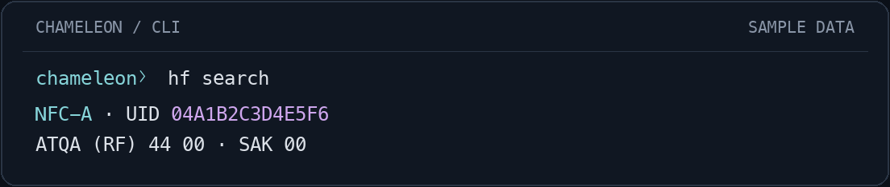
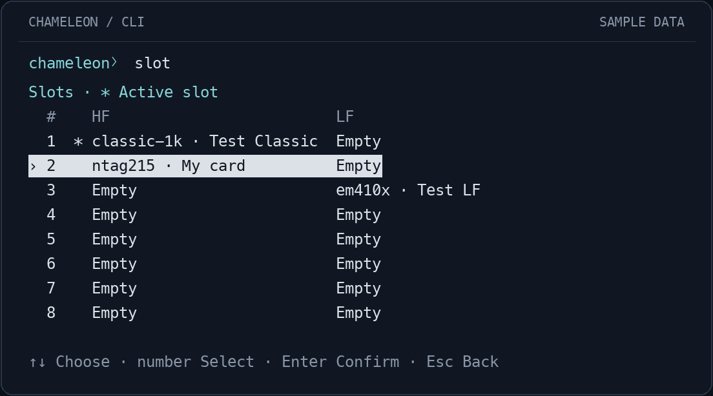
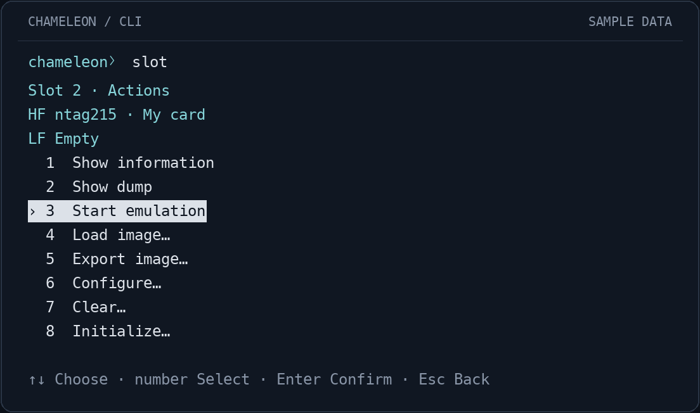
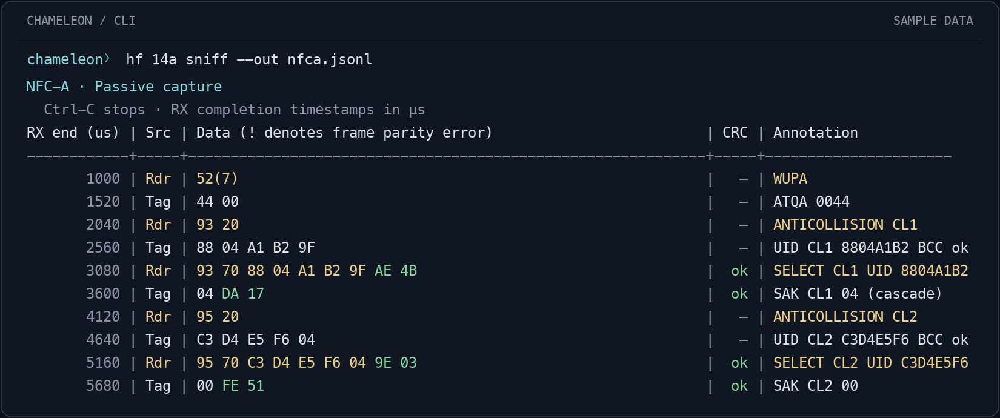

# Chameleon Unleashed console

Open the console, read a card, and manage your emulation slots. Use guided menus
or copy the commands below directly into the console.

[Read a card](#read-a-card) · [Slots & emulation](#slots--emulation) ·
[Sniff an exchange](#sniff-an-exchange) · [Full reference](REFERENCE.md)

## Open the console

Download and extract the [archive for your platform](../../docs/releases.md), then
add its folder to your `PATH`. Connect one Ultra over USB with matching firmware.

```sh
chameleon
```

Keep this console open for the steps below. Copy only the command text; the
`chameleon〉` prompt is already there. **Tab** completes commands, options and paths.

<details>
<summary>Run without PATH, build from source, or select a device</summary>

From the extracted folder, replace `chameleon` with `./chameleon` on macOS/Linux
or `.\chameleon.exe` in Windows PowerShell.

To build from the repository root:

```sh
./dev build cli
```

The executable is `software/target/release/chameleon`.
See [build prerequisites](../../docs/README.md#local-development).

With multiple devices, select one by adding `--port DEVICE_PORT` when opening
the console.

</details>

## Read a card

Place a card on the HF antenna and identify it:

```sh
hf search
```



<sub>Previews use synthetic data rendered by the CLI; they are not recordings
of hardware sessions.</sub>

For an **NTAG** (such as NTAG215), save its memory:

```sh
hf mfu dump --output tag.json
```

Keep JSON as your backup: it preserves partial reads and unknown bytes. Existing
files are never overwritten; choose a new filename for another capture.
Older Ultralight models need an explicit `--model`;
see [NTAG / Ultralight options](REFERENCE.md#ntag-and-ultralight-inspection).

Other cards: [MIFARE Classic](REFERENCE.md#classic-recovery) ·
[NFC-V / ST25TB](REFERENCE.md#nfc-b-st25tb-and-nfc-v) ·
[DESFire](REFERENCE.md#desfire-public-captures) · [LF](REFERENCE.md#lf-tags).

## Device status

```sh
chameleon status
chameleon status --verbose
```

`status` shows device/USB/battery, selected HF/LF images and activation, BLE
pairing requirements, animation, wake timeout and button assignments. Pairing
keys are hidden. `--verbose` adds hardware identity, selected firmware features
and image identity/settings via frozen snapshots, which briefly pause RF.
Neither command changes mode or slot; unavailable details are labelled explicitly.

## Slots & emulation

Open the guided slot menu:

```sh
slot
```



**Choose a slot, then press Enter.** `›` follows your selection; `*` marks the
active device slot. Each slot can hold an HF and an LF image.



Choose **Load image…** to import an NTAG/Ultralight JSON capture, a JSON slot
backup, or a Flipper `.nfc` image. Reopen the menu and choose **Start emulation**.
Loading saves and verifies the image; replacing an existing image asks for
confirmation.

Load the NTAG capture above into slot 2:

```sh
slot load tag.json 2 --name "My card"
```

Loading may ask to fill unknown credentials or metadata with emulator defaults.
Review that choice: defaults can affect authentication and originality checks.
Unread user/configuration pages prevent loading. The original capture stays unchanged.

Then start emulation:

```sh
slot start 2
```

Emulation continues after the CLI exits, while the Ultra is powered. Both enabled
HF/LF images run. Stop before editing stored data:

```sh
slot stop
```

To back up a stored HF image, choose **Export image…** in the menu and save as
JSON to preserve its exact activation data and emulator settings.
[Slot formats and settings →](REFERENCE.md#slots-and-emulation)

## Sniff an exchange

Place the Ultra between a reader and card. Connect over USB with no active BLE
connection, start the capture, then present the card to the reader:

```sh
hf 14a sniff --out nfca.jsonl
```



**Ctrl-C stops and keeps the capture.** Reader frames are yellow, tag frames light
gray; CRC bytes are green when valid and red on errors. `nfca.jsonl` retains raw
frames and annotations. Use a new filename for each capture.

For NFC-V, replace `hf 14a` with `hf 15`. Add `--duration 10` for a timed capture.
Frames can be missed; timestamps are RX completion times, not RF delays. Crypto1
traffic is not decrypted. [Capture options and limits →](REFERENCE.md#passive-sniffers)

## Keep going

- [Update firmware](REFERENCE.md#usb-firmware-updates)
- [Restore a physical card](REFERENCE.md#physical-nfc-a-restoration)
- [All workflows, formats and limits](REFERENCE.md)

For command options:

```sh
help hf mfu
```

<sub>Console: **Tab** complete · **↑↓ / Ctrl-R** history · **Esc** back ·
**Ctrl-C** cancel · **Ctrl-D** exit. Menus: **↑↓**, then **Enter**.</sub>

<details>
<summary>Scripts, history, colors and writing to cards</summary>

From your usual terminal or a script, prefix a command with `chameleon`.
See the [full reference](REFERENCE.md) for standalone examples.

History is stored in `chameleon/history.txt` under local application data;
`CHAMELEON_DATA_DIR` relocates it. Start a console command with a space to keep it
out of history, especially when it contains credentials. Use `--no-color` or
`NO_COLOR=1` to disable colors.

For writes, use `--dry-run` where available to preview changes. Interactive
confirmations default to **No**; scripts use `--yes`. After an uncertain write
reply, inspect the target before retrying. Ctrl-C waits for radio cleanup.

</details>
