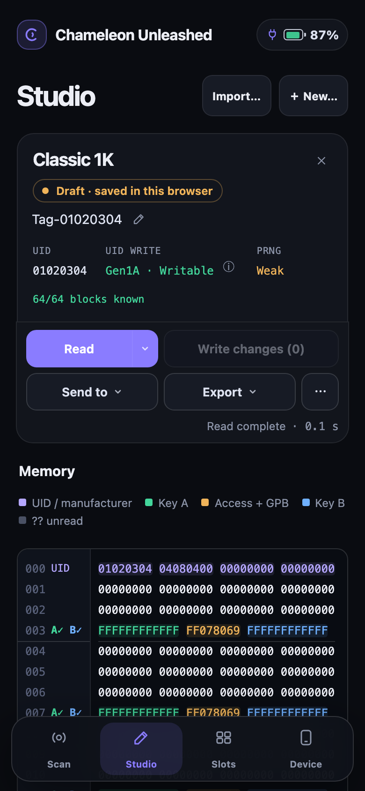
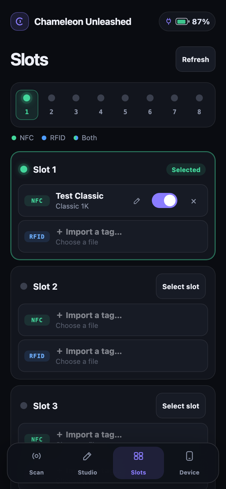

# Chameleon Unleashed web interface

Connect an Ultra with matching firmware over USB and open
[192.168.16.1](http://192.168.16.1). Use one active browser client.
Internet access is needed to download the matching app resources.

Select **NFC** or **RFID**, place a tag on the antenna and choose **Tap to Scan**.
Studio opens when the tag is identified. You can also **Import…** a file or
start with **New…**.

## Studio and slots

| Studio | Slots |
| :---: | :---: |
|  |  |

Mobile layout with demo data. Click a screenshot to enlarge it.

- **Read** acquires memory; for Classic, it also recovers keys.
- **Export → JSON file** saves a backup, including partial reads and device settings.
- **Send to** saves to a **Slot…**, starts **Slot & emulate**, or guides copying
  to a physical tag (**Copy to a tag…** / **Program a tag…**).

In **Slots**, select the slot to emulate and enable its NFC/RFID sides.
Emulation continues while the Ultra is powered, even after closing the browser.

Editing a document changes it locally. **Write changes** applies those edits
to a compatible physical tag. `??` means unread or unknown bytes.
After an interrupted write or upload, inspect the target before retrying.
Export documents you want to keep; browser storage is not a permanent backup.

## Offline use

Resources are saved automatically in the browser when Internet is available.
Before going offline, check **Device → Offline use → Ready offline** in the
browser you will use. Use **Retry preparation** if preparation is incomplete.
**Session only** does not survive a reload.
